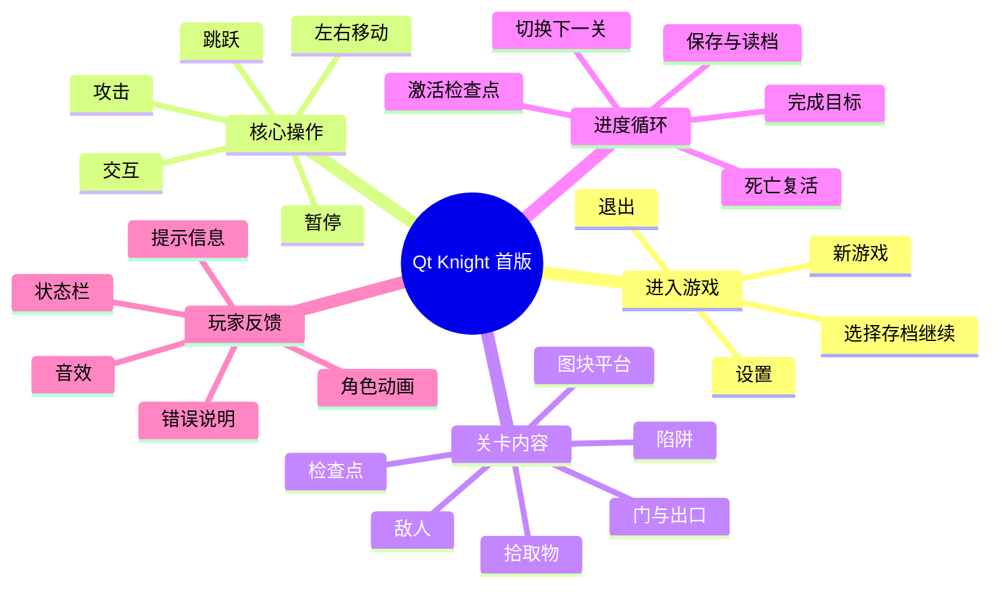
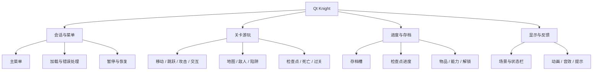
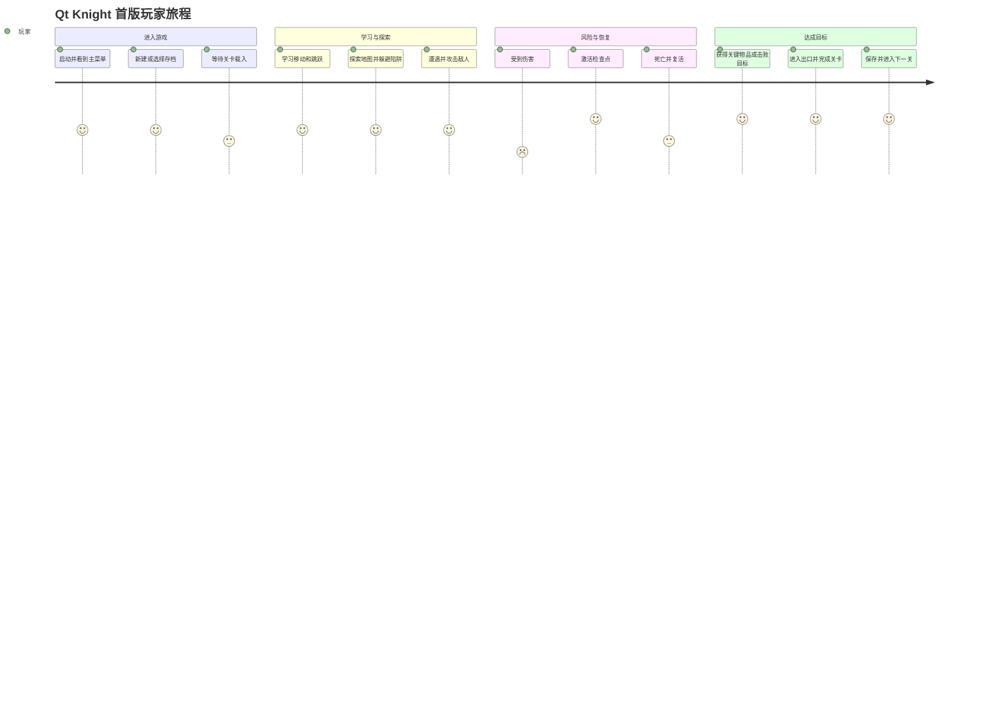
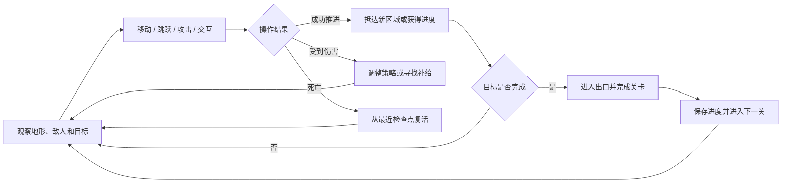
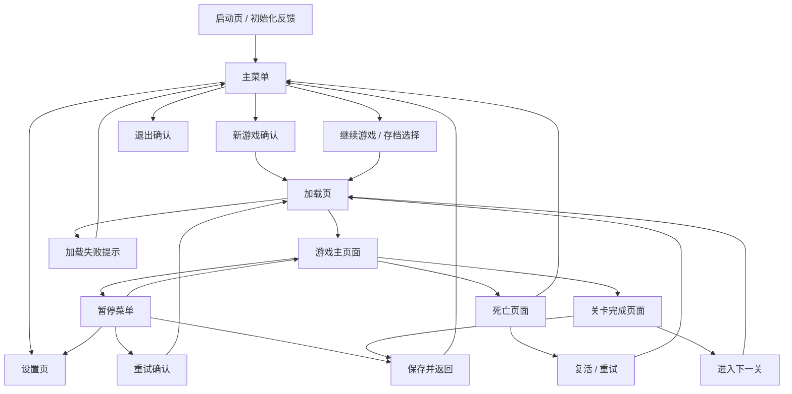
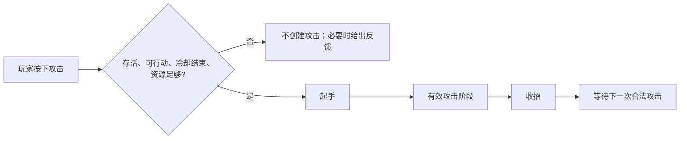
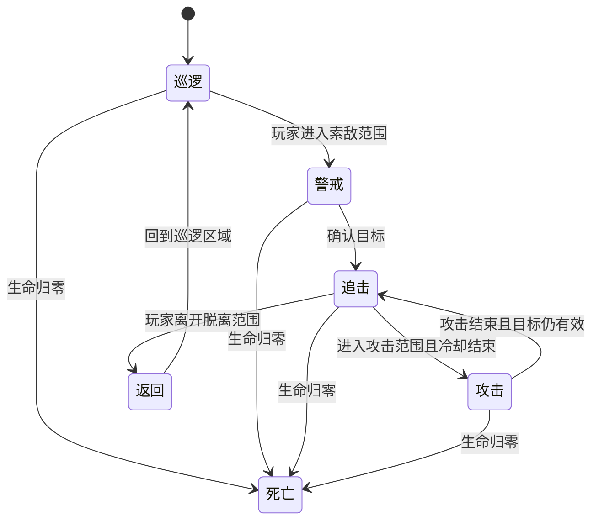
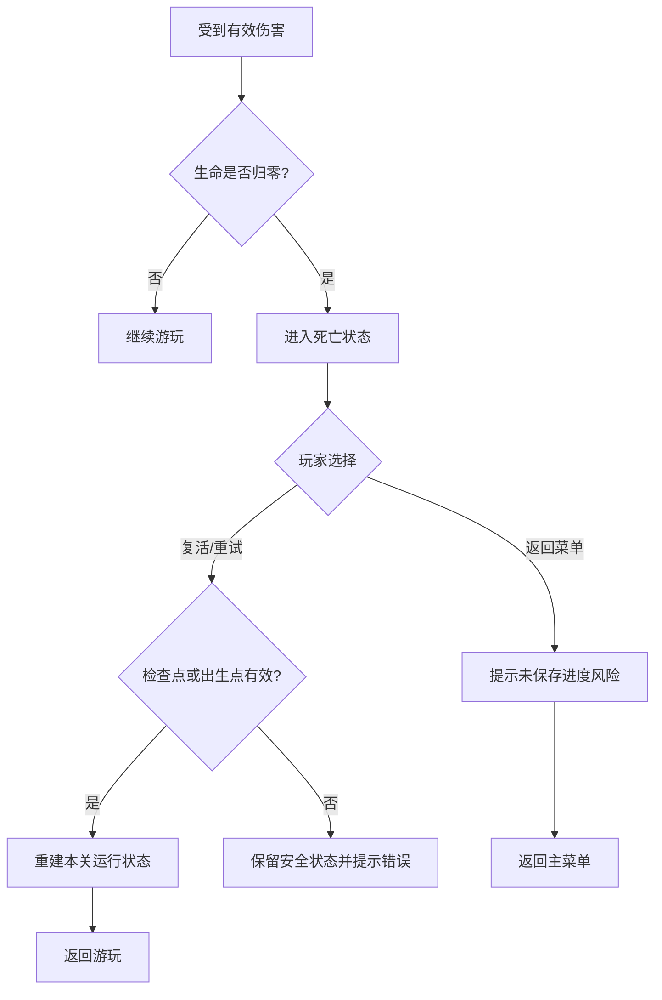
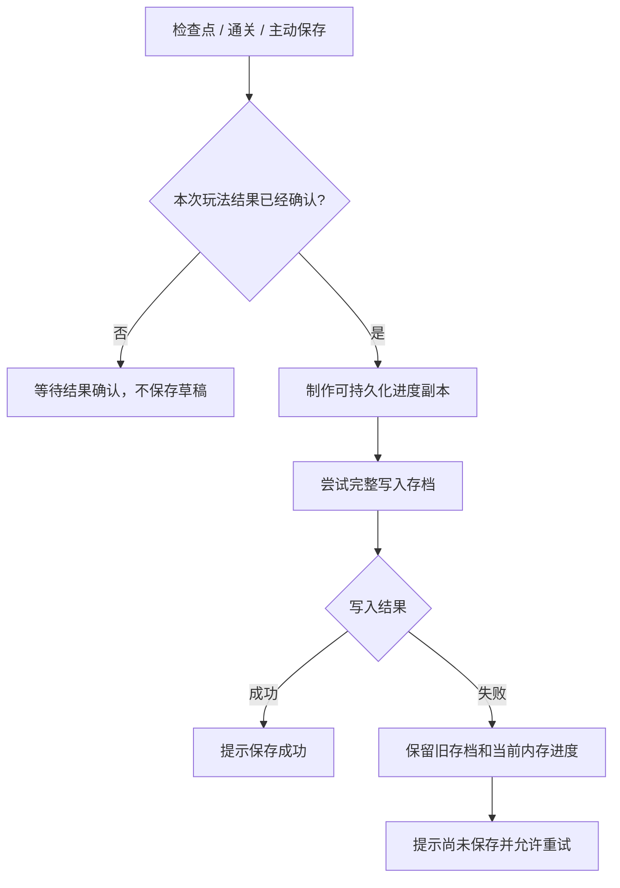
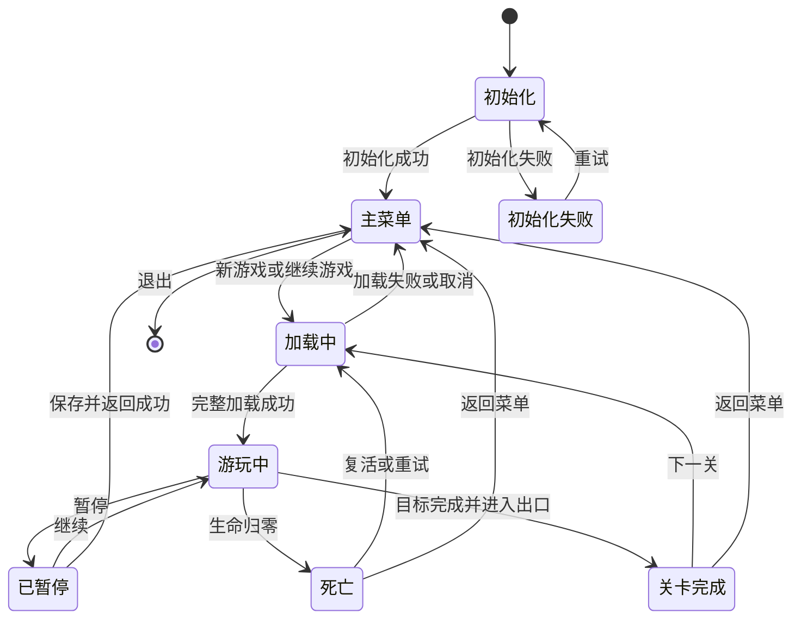

# Qt Knight 游戏业务需求文档

| 项目项 | 内容 |
|---|---|
| 文档版本 | V1.0 |
| 文档类型 | 游戏业务需求文档（BRD/产品需求基线） |
| 编写角色 | 产品经理 |
| 主要读者 | 软件设计工程师、开发人员、测试人员、美术与音频协作者 |
| 产品阶段 | 首个可玩版本（MVP）需求定义 |
| 文档状态 | 待团队评审 |
| 更新日期 | 2026-10-15 |

> 本文只描述产品要解决的问题、玩家能做什么、页面与玩法如何表现、失败时如何处理，以及怎样验收。本文不规定 DLL、类、函数、数据库表或代码目录；这些内容由后续《软件设计文档》根据本文逐项转化。

## 1. 文档目的

本文为 Qt Knight 首个可玩版本建立统一的业务需求基线，使软件设计工程师能够据此划分系统职责、设计状态与接口，使开发和测试人员能够据此判断功能是否符合产品预期。

本文需要回答以下问题：

1. 玩家为什么进入游戏，以及完整体验是什么。
2. 游戏包含哪些页面，各页面能执行什么操作。
3. 移动、跳跃、攻击、敌人、陷阱、检查点、过关和存档如何表现。
4. 哪些行为允许发生，哪些行为必须被阻止。
5. 文件损坏、保存失败、窗口失焦等异常发生时，玩家会看到什么。
6. 首版做什么、不做什么，以及最终如何验收。

## 2. 产品概述

### 2.1 产品定位

Qt Knight 是一款面向 Windows 桌面的二维横版动作闯关游戏。产品参考《Hollow Knight》的探索、移动和战斗节奏，但使用独立制作的关卡、角色、美术、音乐与故事表达。

玩家从主菜单进入关卡，在图块地图中移动、跳跃、攻击、躲避陷阱、击败敌人、取得关键物品、激活检查点并完成关卡目标。玩家死亡后可从最近检查点复活；关键进度可以保存，并在下次启动时恢复。

### 2.2 产品目标

| 编号 | 目标 | 可观察结果 |
|---|---|---|
| PG-001 | 建立完整的横版闯关闭环 | 玩家能从菜单进入游戏，完成关卡并进入下一关 |
| PG-002 | 提供可学习、可预测的动作反馈 | 同一操作在相同情境下得到一致结果 |
| PG-003 | 保护玩家进度 | 保存失败或内容加载失败时，不破坏已有存档和当前安全状态 |
| PG-004 | 支持中断后继续游玩 | 退出并重新启动后，可从最近已保存检查点继续 |
| PG-005 | 形成可扩展的首版内容框架 | 首版完成后可继续增加关卡、敌人、陷阱和物品，而不改变基础玩法语义 |

### 2.3 产品范围思维导图



可编辑版本：[产品范围思维导图](assets/product-scope-mindmap.excalidraw)。

### 2.4 目标用户

- 喜欢二维横版移动、战斗与轻度探索的玩家。
- 能够使用键盘完成即时操作的桌面游戏用户。
- 首版以单人离线体验为主，不要求账号、联网或多人协作。

### 2.5 首版范围

首版必须具备：

- 至少 3 个可按顺序完成的关卡。
- 至少 2 类陷阱，其中至少一类为持续危险区，一类为周期危险机关。
- 至少 2 类敌人行为组合，例如巡逻近战敌人与索敌追击敌人。
- 至少 1 个需要关键物品或目标条件才能开启的门或出口。
- 新游戏、继续游戏、暂停、重试、复活、保存并返回菜单、正常退出。
- 移动、跳跃、攻击、受伤、死亡、拾取、检查点、过关、切关、存档和读档。
- 基本的画面、状态栏、提示、音效和失败反馈。

首版明确不包含：

- 联机、排行榜、云存档和账号系统。
- 复杂剧情分支、对话树和任务编辑器。
- 完整技能树、装备构筑和大量角色养成。
- 玩家自制关卡和游戏内关卡编辑器。
- 精确恢复到退出前某一帧的即时存档。

## 3. 产品业务结构



### 3.1 主要业务对象

| 对象 | 产品含义 | 玩家是否直接看见 |
|---|---|---|
| 玩家 | 玩家操控的角色，具有位置、生命、能量、能力、物品和当前检查点 | 是 |
| 敌人 | 按规则巡逻、索敌、追击和攻击玩家的角色 | 是 |
| 地图 | 定义平台、障碍、危险区域、交互区域和可见场景 | 是 |
| 陷阱 | 在满足接触或周期条件时对玩家造成伤害 | 是 |
| 攻击 | 有起手、有效和收招过程的一次战斗动作 | 是 |
| 拾取物 | 玩家接触或交互后获得的补给、关键物品或能力 | 是 |
| 检查点 | 记录复活位置并触发进度保存的安全节点 | 是 |
| 门与出口 | 根据物品或关卡目标决定是否开放的通路 | 是 |
| 存档槽 | 保存可跨会话恢复的玩家进度 | 是 |

## 4. 玩家旅程与核心循环

### 4.1 完整玩家旅程



### 4.2 核心玩法循环



可编辑版本：[核心玩法循环](assets/core-gameplay-loop.excalidraw)。

### 4.3 最小可玩闭环

首个可玩版本必须至少贯通以下路径：

```text
启动 → 新游戏 → 进入第一关 → 移动与跳跃 → 攻击敌人
→ 接触陷阱并受伤 → 激活检查点 → 完成关卡目标
→ 进入出口 → 保存 → 退出 → 重新启动 → 从存档继续
```

## 5. 页面与导航设计

### 5.1 页面信息架构



可编辑版本：[页面导航图](assets/page-navigation.excalidraw)。

### 5.2 全局页面原则

| 编号 | 要求 |
|---|---|
| UI-001 | 所有页面必须明确展示当前可执行操作，禁止让玩家猜测如何继续或返回 |
| UI-002 | 加载、保存、错误和不可用状态必须有可见反馈 |
| UI-003 | 菜单焦点、鼠标悬停和确认操作必须有明显视觉变化 |
| UI-004 | 游戏页面上的 HUD 不应遮挡主要移动路线和战斗区域 |
| UI-005 | 同一类按钮的文字、位置和交互方式应保持一致 |
| UI-006 | 错误提示必须告诉玩家“发生了什么”和“接下来可以做什么” |

### 5.3 页面详细需求

#### 5.3.1 启动页

- 展示游戏标识和初始化状态。
- 初始化成功后自动进入主菜单。
- 初始化失败时展示简明原因，并提供“重试”和“退出”。
- 初始化期间不得进入半完成的关卡页面。

#### 5.3.2 主菜单

必须提供：

- 新游戏
- 继续游戏
- 设置
- 退出游戏

当没有可用存档时，“继续游戏”应显示为不可用或进入空槽位说明页面，不能表现成系统故障。

#### 5.3.3 新游戏确认

- 告知玩家将创建新存档。
- 如果未来支持覆盖已有槽位，必须二次确认；首版默认选择空槽位。
- 确认后进入加载页，取消则返回主菜单。

#### 5.3.4 存档选择页

首版提供 3 个可见存档槽。每个非空槽至少显示：

- 槽位编号
- 当前关卡
- 最近检查点
- 最后保存时间

空槽位明确显示“空”。损坏或版本不兼容的槽位显示“无法读取”，并允许返回或选择其他槽位，不得自动覆盖。

#### 5.3.5 加载页

- 显示正在加载的目标，例如“正在进入第一关”。
- 加载完成前不接受移动、跳跃、攻击和交互。
- 加载失败时进入错误提示，不显示半完成场景。
- 从已有安全会话切换关卡失败时，保留原安全状态并允许重试。

#### 5.3.6 游戏主页面

页面由场景区域和 HUD 组成。

HUD 至少显示：

- 当前生命与生命上限
- 当前能量与能量上限
- 必要的关卡目标或目标更新提示
- 交互提示
- 保存成功、保存失败、门未开启等短时消息

场景区域展示地图、玩家、敌人、陷阱、拾取物、检查点、出口和必要特效。镜头以玩家为中心跟随，但不能越过关卡相机边界。

#### 5.3.7 暂停菜单

必须提供：

- 继续游戏
- 重试当前检查点
- 设置
- 保存并返回主菜单

暂停期间游戏世界必须停止推进；菜单动画和按钮交互可以继续。

#### 5.3.8 死亡页面

- 清晰展示玩家已死亡。
- 提供“从最近检查点复活”和“返回主菜单”。
- 没有有效检查点时，从本关默认出生点重试。
- 返回主菜单前如存在未保存进度，必须提示可能丢失。

#### 5.3.9 关卡完成页面

- 展示关卡完成反馈。
- 提供“进入下一关”；最后一关改为“完成游戏/返回主菜单”。
- 提供“返回主菜单”。
- 若完成进度尚未保存成功，必须明确显示，并允许再次保存。

#### 5.3.10 设置页

首版至少支持：

- 主音量和音效音量
- 默认键位查看与重新绑定
- 恢复默认设置

键位冲突时必须提示并要求玩家重新选择，不得静默覆盖关键操作。

## 6. 输入与操作需求

### 6.1 默认操作

| 动作 | 默认键位 | 类型 | 产品规则 |
|---|---|---|---|
| 向左移动 | A / ← | 持续动作 | 按住期间持续产生左移意图 |
| 向右移动 | D / → | 持续动作 | 按住期间持续产生右移意图 |
| 跳跃 | Space | 单次动作 | 每次真实按下最多申请一次跳跃 |
| 攻击 | J | 单次动作 | 每次真实按下最多申请一次攻击 |
| 交互 | E | 单次动作 | 用于拾取、检查点、门和出口 |
| 暂停/返回 | Esc | 单次动作 | 游玩中暂停，菜单中返回上一级 |
| 菜单确认 | Enter / 鼠标左键 | 单次动作 | 确认当前选项 |

### 6.2 通用输入规则

| 编号 | 规则 |
|---|---|
| IN-001 | 按住移动键时，玩家应持续移动，直至松开、受阻、暂停或失焦 |
| IN-002 | 左右键同时按住时，水平移动意图相互抵消 |
| IN-003 | 长按跳跃、攻击或交互不得被键盘自动重复识别为多次新操作 |
| IN-004 | 按住移动时再次按攻击，移动和攻击必须分别被识别，不能相互覆盖 |
| IN-005 | 窗口失去焦点时，所有按住状态必须释放；恢复焦点后需重新按键 |
| IN-006 | 菜单输入和战斗输入互斥，暂停菜单开启时不得继续控制角色 |

## 7. 核心玩法需求

### 7.1 移动

- 玩家可在可通行区域左右移动。
- 墙壁和实心平台必须阻止玩家穿透。
- 撞墙后继续按住方向键，角色不得逐帧挤入墙体。
- 移动方向改变时，角色朝向和动画应同步变化。
- 显示插值不得改变实际玩法位置或碰撞结果。

### 7.2 跳跃

- 玩家只有在剩余跳跃次数允许时才能起跳。
- 持续按住跳跃键不能反复起跳；必须松开后再次按下。
- 撞到顶部障碍时停止向上穿透。
- 落地后恢复关卡规则允许的跳跃次数。
- 最大跳跃次数、跳跃速度和重力属于可配置的关卡/角色数值，但规则语义不变。

### 7.3 攻击

一次攻击由三个可感知阶段组成：



业务规则：

- 只有有效攻击阶段可以命中目标。
- 攻击判定使用角色完成碰撞修正后的实际站位。
- 一次挥击对同一个目标最多造成一次伤害。
- 友方目标不受伤；首版玩家与敌人属于不同阵营。
- 攻击冷却结束前再次按下不会创建新攻击。
- 攻击命中、受击和死亡分别产生可见或可听反馈。

### 7.4 敌人

首版敌人至少支持以下状态语义：



- 索敌距离和脱离距离应分开，以避免敌人在边界反复切换状态。
- 敌人受到地图阻挡约束，不能因追击穿过实心墙体。
- 死亡敌人停止移动和攻击，并按关卡规则计入目标。
- 首版不要求复杂路径搜索，但敌人的失败行为必须稳定可预测。

### 7.5 陷阱与受伤

- 持续危险区在玩家进入有效区域时尝试造成伤害。
- 周期机关只在其危险阶段造成伤害，不能由画面动画是否播放决定。
- 玩家受伤后获得短暂无敌时间，避免每一帧连续扣血。
- 持续接触同一陷阱还应受再次伤害间隔约束。
- 有效伤害至少产生生命下降、受伤反馈；配置允许时产生击退。
- 生命降至零时进入死亡流程。

### 7.6 拾取与交互

- 玩家进入交互范围并执行交互操作后，才完成需要主动交互的对象。
- 拾取成功后，对象不得再次被重复拾取。
- 关键物品应立即反映在内存进度中，并在下一次合法保存时写入存档。
- 条件不满足的门或出口不得开启，应显示可理解的提示。
- 同一帧玩家死亡时，拾取、检查点和出口成功判定全部取消。

### 7.7 检查点

- 玩家满足条件并交互后激活检查点。
- 激活成功后更新最近复活位置，并请求保存进度。
- 检查点的画面或音效应明确区分未激活和已激活状态。
- 保存失败时，当前会话中的检查点仍然有效，但必须提示“本次进度尚未保存”。

### 7.8 死亡、复活和重试



复活时：

- 玩家回到最近有效检查点；没有检查点时回到关卡默认出生点。
- 玩家生命按复活规则恢复。
- 本关敌人和陷阱恢复为重试规则规定的初始状态。
- 已持久化的能力、关键物品和永久机关保持不变。
- 复活准备失败时不能留下半个世界。

### 7.9 关卡目标、门和出口

首版支持以下目标组合：

- 抵达出口。
- 持有指定关键物品并抵达出口。
- 击败指定敌人或完成指定目标后抵达出口。

所有必要条件满足前，出口可以显示但不得切换关卡。完成条件后进入出口，应先确认本关完成和进度，再允许玩家进入下一关。

### 7.10 进入下一关

- 下一关全部内容可用后才切换画面和角色世界。
- 下一关加载失败时，保留当前已完成关卡的安全状态。
- 玩家可以重试加载或返回主菜单。
- 不得先删除当前关卡，再因下一关失败而只留下错误页面。

## 8. 游戏内容需求

### 8.1 关卡结构

每个关卡至少包含：

- 玩家出生点。
- 可通行与不可通行的地图区域。
- 至少一个风险要素（敌人或陷阱）。
- 至少一个检查点或明确的重试起点。
- 明确的关卡目标和出口。
- 必要的图片、动画、音效和提示资源。

### 8.2 首版三关建议

| 关卡 | 教学与体验重点 | 必要内容 |
|---|---|---|
| 第一关 | 学习移动、跳跃、基础攻击和检查点 | 基础平台、静态尖刺、巡逻敌人、检查点、普通出口 |
| 第二关 | 学习周期陷阱、追击敌人和关键物品 | 周期机关、索敌追击敌人、钥匙、上锁的门 |
| 第三关 | 综合运用并完成首版闭环 | 两类敌人与陷阱组合、目标敌人、最终出口、完成游戏反馈 |

具体地图布局和数值由关卡设计稿另行定义，但不得改变本文规定的交互语义。

## 9. 存档与进度需求

### 9.1 保存内容

存档需要保存：

- 当前关卡
- 最近检查点
- 用于恢复的生命和能量
- 已解锁能力
- 关键物品
- 永久机关状态
- 已完成目标与关卡解锁状态

存档不保存：

- 玩家或敌人的实时精确坐标
- 当前速度
- 正在进行的攻击
- 陷阱当前动画帧或周期相位
- 敌人当前追击目标和即时决策状态

### 9.2 保存时机

- 创建新游戏槽位时。
- 激活检查点后。
- 完成关卡后。
- 玩家选择“保存并返回主菜单”时。

### 9.3 保存流程



### 9.4 读档规则

- 读档前检查槽位是否存在、格式是否受支持、引用关卡是否存在。
- 读档成功后，从保存的关卡和检查点恢复。
- 存档损坏或版本不兼容时，不覆盖当前安全会话。
- 不支持的旧存档必须明确提示，禁止静默删除或重置。

## 10. 会话状态与业务边界

### 10.1 会话状态图



### 10.2 操作优先级

| 优先级 | 同一时刻出现的业务事件 | 处理要求 |
|---|---|---|
| 1 | 暂停与玩法输入 | 先暂停，本次不推进玩法 |
| 2 | 致命伤害与交互 | 先死亡，取消拾取、检查点和出口 |
| 3 | 碰撞修正与攻击命中 | 先完成站位修正，再判定命中 |
| 4 | 世界变化与画面/音效 | 先确认玩法结果，再播放成功反馈 |
| 5 | 世界变化与存档 | 只保存已经确认的进度，不保存中间草稿 |

### 10.3 产品边界

| 边界 | 必须遵守的产品规则 |
|---|---|
| 画面边界 | 画面展示不能反过来决定玩家位置、碰撞、伤害或陷阱状态 |
| 输入边界 | 界面只表达玩家动作；键盘自动重复不等于多次真实操作 |
| 时间边界 | 窗口卡顿、暂停或切换焦点不能让世界突然向前跳过数秒 |
| 保存边界 | 只保存可恢复进度，不保存完整瞬时世界 |
| 关卡边界 | 新关卡准备成功前不得破坏当前安全状态 |
| 错误边界 | 失败必须可见、可理解、可重试，不得静默丢失进度 |

可编辑版本：[异常与安全边界](assets/safety-boundaries.excalidraw)。

## 11. 异常与恢复需求

| 编号 | 异常 | 玩家可见行为 | 系统必须保护的内容 |
|---|---|---|---|
| ER-001 | 关卡文件缺失或内容不合法 | 显示目标关卡加载失败，可重试或返回 | 当前安全会话和已有存档 |
| ER-002 | 存档损坏或版本不兼容 | 标记该槽位无法读取，可选择其他槽位或新游戏 | 其他槽位和当前会话 |
| ER-003 | 存档写入失败 | 提示“本次进度尚未保存”，允许再次保存 | 旧存档和内存中的最新进度 |
| ER-004 | 下一关不存在或加载失败 | 留在本关已完成状态，可重试 | 本关完成结果和当前进度 |
| ER-005 | 窗口失焦 | 释放按住输入，恢复后等待重新操作 | 玩家位置和会话状态 |
| ER-006 | 帧率卡顿 | 限制追赶，不让游戏瞬间推进数秒 | 玩法时间的一致性 |
| ER-007 | 必要运行文件缺失 | 启动前或初始化时明确指出缺失，禁止进入游玩 | 存档文件和用户设置 |

异常流程的可编辑图源见：[异常与安全边界](assets/safety-boundaries.excalidraw)。

## 12. 视觉、音频和可用性需求

### 12.1 视觉反馈

- 玩家、敌人、陷阱和交互物应能凭外观或提示区分。
- 起跳、攻击、受击、死亡、拾取、检查点和过关必须有清晰反馈。
- 无敌时间内应有可辨识的角色效果，但效果不决定无敌是否生效。
- 锁定出口、可交互对象和保存失败必须有文字或图标提示。

### 12.2 音频反馈

至少为以下事件提供音效：

- 菜单确认和返回
- 玩家跳跃和攻击
- 攻击命中和玩家受伤
- 拾取物品
- 激活检查点
- 门开启或出口解锁
- 玩家死亡和关卡完成
- 保存成功或失败提示

### 12.3 可用性

- 关键操作支持键位重绑。
- 重要信息不能只依赖颜色表达，还应配合图标、文字、动画或声音。
- 短时提示应保留足够时间供玩家阅读，并避免同时堆叠过多信息。
- 错误弹窗关闭后必须有明确去向，不能进入不可操作页面。

## 13. 性能与质量目标

| 编号 | 目标 |
|---|---|
| NFR-001 | 在推荐硬件上以 60 FPS 为画面流畅目标，玩法逻辑保持稳定一致 |
| NFR-002 | 正常关卡切换目标不超过 5 秒；超时应持续显示加载反馈而不是假死 |
| NFR-003 | 输入、碰撞、攻击和伤害在重复测试中产生可复现结果 |
| NFR-004 | 连续完成三关过程中不发生崩溃、卡死或无法继续的状态 |
| NFR-005 | 模拟保存失败后，重新启动仍能读取失败前的旧存档 |
| NFR-006 | 切换窗口焦点、暂停和恢复不能造成角色自行移动或重复攻击 |

## 14. 验收场景

### 14.1 功能验收

| 编号 | 场景 | 前置条件 | 操作 | 预期结果 |
|---|---|---|---|---|
| AC-001 | 新游戏 | 无当前会话 | 主菜单选择新游戏 | 创建存档并进入第一关；失败则留在主菜单并显示原因 |
| AC-002 | 继续游戏 | 存在有效槽位 | 选择槽位继续 | 从已保存关卡和最近检查点恢复 |
| AC-003 | 持续移动和连续攻击 | 玩家存活且可行动 | 按住右移，多次松开并重按 J | 移动持续；冷却结束后的每次新按下均可攻击 |
| AC-004 | 墙体与撞顶 | 玩家靠近墙壁或顶部 | 持续移动或跳跃 | 不穿墙、不穿顶，位置和速度反馈正确 |
| AC-005 | 陷阱连续接触 | 玩家进入持续危险区 | 保持接触 | 按无敌时间和再次伤害间隔扣血，不按画面帧扣血 |
| AC-006 | 同帧死亡与检查点 | 玩家生命将归零且进入检查点 | 同一时刻受致命伤害并交互 | 进入死亡，检查点不激活 |
| AC-007 | 检查点保存失败 | 可模拟数据库写入失败 | 激活检查点 | 当前会话复活点更新；提示尚未保存；旧存档仍可读取 |
| AC-008 | 死亡复活 | 已激活检查点 | 死亡后选择复活 | 回到检查点，永久进度保留，运行场景按规则重建 |
| AC-009 | 目标未完成进入出口 | 出口条件未满足 | 进入并交互 | 不切关，显示缺少条件的提示 |
| AC-010 | 下一关加载失败 | 当前关完成、下一关不可用 | 选择下一关 | 保留本关完成状态，允许重试或返回菜单 |
| AC-011 | 窗口失焦 | 正在按住移动键 | 切换到其他窗口再返回 | 角色不会自行继续移动，需重新按键 |
| AC-012 | 保存并返回 | 存档写入可用 | 暂停菜单选择保存并返回 | 保存确认后返回主菜单并可继续读取 |
| AC-013 | 损坏存档 | 存档格式错误 | 在存档页选择该槽位 | 不进入关卡，不覆盖存档，展示明确错误 |
| AC-014 | 完成三关 | 内容完整 | 连续游玩至最终出口 | 显示完成反馈，进度可保存并重新读取 |

### 14.2 产品完成定义

首版只有同时满足以下条件才视为完成：

1. AC-001 至 AC-014 全部通过。
2. 三个关卡可按顺序完成，且至少覆盖两类陷阱、两类敌人行为和一个关键物品门。
3. 新游戏、读档、检查点、死亡、复活、过关、保存、退出和再次继续形成闭环。
4. 所有失败场景均不会破坏已有存档或留下不可操作的半完成会话。
5. 页面能够明确表达当前状态、可执行操作和错误恢复方式。

## 15. 后续软件设计文档的输入要求

软件设计工程师应基于本文继续产出《Qt Knight 软件设计文档》，并满足：

- 将每条 `PG`、`UI`、`IN`、`ER`、`NFR`、`AC` 需求映射到明确的软件职责。
- 给出页面层、业务协调层和底层能力的职责与依赖规则。
- 给出会话状态、游戏对象、关卡配置、运行状态和存档数据的技术模型。
- 给出各模块需要开发的公开函数、输入、输出、错误码和所有权。
- 给出每条核心玩法从输入到最终状态更新和画面反馈的调用顺序。
- 给出构建、部署、测试和两人协作边界。
- 技术设计不得改变本文确定的玩家可见行为；如确需改变，必须先更新并重新评审本文。

## 16. 评审清单

产品评审时，参与者应逐项确认：

- [ ] 首版范围和非范围是否清楚。
- [ ] 三关、敌人、陷阱和关键物品门是否满足课程或项目目标。
- [ ] 所有页面是否有明确入口、出口和失败去向。
- [ ] 移动、跳跃、攻击、交互和暂停的输入语义是否明确。
- [ ] 同帧冲突、死亡优先、攻击去重等玩法边界是否明确。
- [ ] 存档保存什么、不保存什么以及失败行为是否明确。
- [ ] 软件设计工程师能否根据需求编号继续进行模块和接口设计。
- [ ] 测试人员能否根据验收场景判断通过或失败。

