# Qt Knight 单机游戏软件设计

## 1. 总体设计

### 1.1 模块职责

| 模块 | 主要类型 | 负责的操作 |
| --- | --- | --- |
| `QtKnightApp` | `MainWindow`、`GamePlayWidget` | 装配页面，处理窗口和键盘事件，将动作与经过时间提交给会话。 |
| `servicelib` | `GameSession` | 持有会话状态和运行世界，调度固定步，提交交互、关卡切换和进度写入。 |
| `maplib` | `LevelLoader` | 读取关卡 JSON，校验后输出 `GameMap` 或关卡摘要列表。 |
| `algorithmlib` | `GameRules` | 接收几何和规则参数，返回速度、碰撞结果、攻击矩形或敌人决策。 |
| `datamanagelib` | `GameMap`、`SaveSlot`、各实体类型 | 保存关卡配置、存档记录和对象状态，提供对象局部规则与 JSON 转换。 |
| `visuallib` | `SceneRenderer`、`AudioPlayer` | 绘制只读世界，按反馈类型和菜单操作播放音效。 |

### 1.2 游戏业务总览

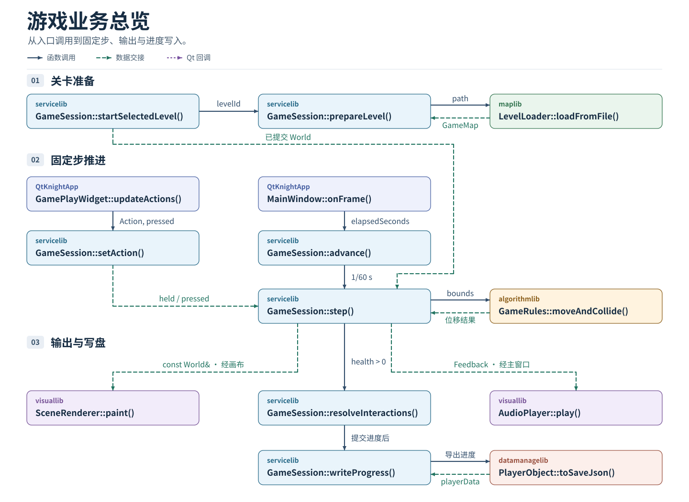

*图 1　游戏业务总览*

进入关卡时，入口函数准备候选 `World`，满足提交条件后由 `activateLevel()` 替换当前世界。游玩时，画布通过 `setAction()` 提交动作变化，主窗口通过 `advance()` 提交经过时间。会话在 `step()` 中按顺序写回运动、战斗与交互结果。

界面绘制时借用 `const World&`，主窗口取走会话反馈并逐条交给音效播放器。检查点与关卡完成结果由会话提交，`writeProgress()` 负责将可恢复进度写入槽文件。

## 2. 数据归属与会话状态

### 2.1 数据归属

| 数据 | 持有者 | 交接与更新 |
| --- | --- | --- |
| `GameMap` | 候选或当前 `World` | `LevelLoader` 填充关卡范围、出生点、静态障碍、生成项和规则。会话据此创建运行对象。 |
| `GameSession::World` | `GameSession` | 保存关卡配置、具体类型的实体和逻辑帧号。会话更新状态，画布和渲染器借用只读引用。 |
| `InputState` | `GameSession` | `held` 记录持续动作，`pressed` 记录按下沿。界面通过动作接口更新，会话在逻辑步中读取。 |
| `SaveSlot` | 存档读取或写入流程 | 保存槽号、关卡编号、保存时间和 `playerData`，由会话读取或写入完整记录。 |
| `Feedback` 队列 | `GameSession` | 记录已确认的结果。`takeFeedback()` 取出并清空队列，主窗口转交每项反馈。 |

### 2.2 datamanagelib 类定义

八个运行实体类共用空间属性。`GameMap` 记录关卡配置与生成项，`SaveSlot` 记录槽位及可恢复进度。

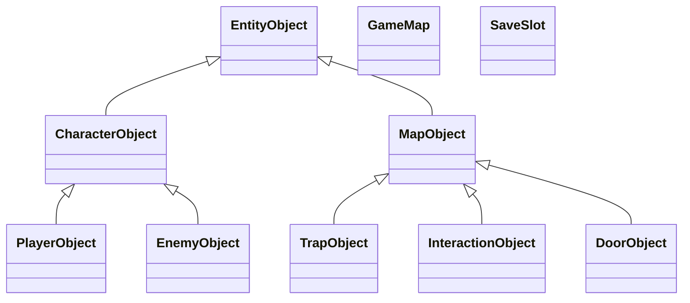

#### 2.2.1 空间与角色基类

| 类 | 字段 | 构造与接口 |
| --- | --- | --- |
| `EntityObject` | `int id`、`QPointF position`、`QSizeF size` | 派生类通过受保护的构造函数传入初始尺寸。`QRectF bounds() const` 返回由位置和尺寸组成的矩形。虚析构处理多态销毁。 |
| `CharacterObject` | `QPointF velocity`，布尔量 `facingLeft`、`onGround`，整数 `health`、`maxHealth`、`attackCooldownFrames` | 受保护构造函数接收尺寸和生命上限，按满血初始化。`virtual int takeDamage(int damage)` 将生命下限约束在 0，并返回实际扣血量。 |
| `MapObject` | 继承 `EntityObject` 的空间字段 | 派生类通过受保护的默认构造函数初始化。`virtual bool isBlocking() const` 默认返回 `false`。 |

`position` 表示碰撞区域的左上角，`size` 表示宽高，单位为像素。坐标向右、向下为正。速度使用像素/秒，加速度使用像素/秒²。冷却、攻击阶段和陷阱周期使用逻辑帧。

#### 2.2.2 玩家与敌人

`PlayerObject` 继承 `CharacterObject`，默认碰撞体为 24×46 像素，生命上限为 `kMaxHealth = 5`，初始能量与能量上限为 `kMaxEnergy = 30`。

| 字段组 | 定义与用途 |
| --- | --- |
| 移动与受伤 | `int jumpsLeft`、`energy`、`maxEnergy`、`invincibleFrames`。无敌剩余帧归零后可受伤。 |
| 攻击 | `AttackPhase attackPhase`、`int attackPhaseFrame`、`QSet<int> attackHitTargets`。阶段分为 `Idle`、`Windup`、`Active`、`Recovery`。阶段内帧偏移从 0 起算，目标集合按一次攻击维护。 |
| 进度 | `quint32 abilities` 保存能力位。`QSet<int>` 字段包括 `keyItems`、`unlockedLevels`、`completedLevels`、`consumedPickupIds`、`openedDoorIds`、`completedGoalIds`。`int currentCheckpointId` 为 0 时使用默认出生点，`bool gameCompleted` 记录全局完成状态。 |

玩家重写 `takeDamage(int)` 检查无敌。`heal(int)` 将回复限制在 `maxHealth`，`spendEnergy(int)` 返回扣除结果，失败时保留 `energy`。`advanceAttack()` 推进当前阶段，`resetAttack()` 清理阶段帧和命中记录，冷却由会话单独更新。两个 JSON 转换函数处理玩家进度层。

`EnemyObject` 继承角色的扣血规则，默认碰撞体为 42×38 像素，生命及上限均为 2。它保存 `EnemyState state`、`QPointF homePosition` 和 `int moveDirection`。状态包括 `Patrol`、`Alert`、`Chase`、`Attack`、`Return`、`Dead`，方向以 `-1`、`0`、`1` 表示左、停止和右。

#### 2.2.3 地图运行对象

| 派生类 | 字段与约定 |
| --- | --- |
| `TrapObject` | 整数字段 `damage`、`periodFrames`、`activeFrames`、`offsetFrames`、`damageIntervalFrames`、`knockback`。`bool isActiveAt(quint64 frameNumber) const` 查询危险期。周期为 0 时表示持续危险。会话处理接触、伤害间隔、扣血和击退。 |
| `InteractionObject` | `Kind` 区分 `Pickup` 与 `Checkpoint`。`requiresInteraction` 选择接触或主动触发，`activated` 表示已拾取或已激活。拾取物的 `Health` 与 `Energy` 使用 `int amount`，`Key` 使用 `int keyItemId`，`Ability` 使用 `quint32 abilityMask`。检查点保存 `QPointF respawnPosition`。 |
| `DoorObject` | `Kind` 区分 `Door` 与 `Exit`。整数 `requiredKeyId`、`requiredEnemyId`、`requiredGoalId` 为 0 时跳过对应条件。出口的 `targetLevelId` 为 0 时表示无后续关卡。`bool canOpen(const PlayerObject& player, bool requiredEnemyAlive) const` 查询条件，由会话提供指定敌人的存活状态。`isBlocking()` 对未开启的门返回 `true`。会话根据对象类别更新 `open` 或提交完成记录。 |

#### 2.2.4 GameMap 关卡配置

`GameMap` 保存 `levelId`、`name`、`subtitle` 和 `nextLevelId`。空间配置由 `QRectF bounds`、`QPointF spawnPoint` 和 `QList<QRectF> solidBounds` 组成，分别表示地图范围、默认出生点与静态障碍。`nextLevelId = 0` 表示无后续关卡。

| 嵌套类型 | 字段用途 |
| --- | --- |
| `MotionRules` | `speed`、`jumpSpeed`、`gravity`、`maxFallSpeed` 均为 `qreal`，供位移和重力计算。`jumpSpeed` 保存大小，向上应用负值。 |
| `AttackRules` | `damage`、`energyCost`、`windupFrames`、`activeFrames`、`recoveryFrames`、`cooldownFrames` 与 `reach`，供阶段推进与命中计算。 |
| `EnemyRules` | `detectDistance`、`disengageDistance`、`patrolSpeed`、`chaseSpeed`、`attackRange`、`attackDamage`、`attackCooldownFrames`，供敌人决策与攻击结算。 |
| `Spawn` | 以 `id`、`kind`、`bounds`、`subtype` 描述生成项，按类别附带初值和条件字段。 |

`QList<Spawn> spawns` 按 `SpawnKind` 创建运行对象。`Enemy` 生成 `EnemyObject`，`Trap` 生成 `TrapObject`，`Pickup` 和 `Checkpoint` 生成 `InteractionObject`，`Door` 和 `Exit` 生成 `DoorObject`。会话将生成矩形的左上角和宽高写入实体的 `position`、`size`，再应用该类别的专用配置。

#### 2.2.5 SaveSlot 存档记录

`SaveSlot` 包含 `int slotNumber`、`int levelId`、`QDateTime savedAt`、`bool corrupted` 和 `QJsonObject playerData`。有效槽号为 1 至 `kSaveSlotCount`，当前共有 3 个槽。槽号 0 表示未绑定，关卡号 0 可表示已建档但尚未选关。`isOccupied()` 将已建档槽和坏槽都视为占用。

`SaveSlot::toSaveJson()` 组装完整槽 JSON，写入格式版本 `kSaveVersion`、槽元数据和内层 `playerData`。`PlayerObject::toSaveJson()` 生成内层进度记录。两种 `loadFromSaveJson()` 分别接收对应层级的数据，失败时返回 `false` 并填写 `errorMessage`，保留原对象。文件读写由 `GameSession` 处理。

### 2.3 会话状态

| 状态 | 进入条件与处理 |
| --- | --- |
| `MainMenu` | 启动或成功退出当前会话后显示主菜单，接受槽位操作。 |
| `LevelSelection` | 建档成功、打开关卡列表或继续未选关的档案时进入，允许确认已解锁关卡。 |
| `Loading` | 准备候选世界。提交成功进入 `Playing`，失败返回发起页面并显示错误。 |
| `Playing` | 接受动作并推进固定步，按结算结果转入暂停、死亡或关卡完成状态。 |
| `Paused` | 冻结逻辑步。继续时从新的输入和经过时间开始。 |
| `Dead` | 停止本步后续交互，等待检查点重建或退出。 |
| `LevelComplete` | 显示完成结果。存在下一关时接受切换，存在待写入的通关进度时接受写入重试。 |

## 3. 初始化与世界提交

### 3.1 应用初始化与槽位读取

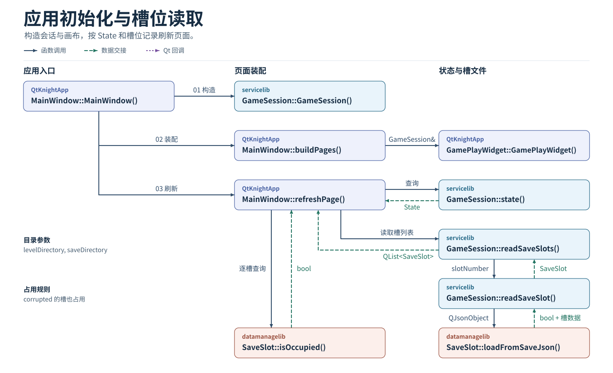

*图 2　应用初始化与槽位读取*

1. `MainWindow` 使用关卡目录与存档目录构造 `GameSession`。`buildPages()` 创建页面与画布，将同一会话交给 `GamePlayWidget`，并登记界面回调。
2. `refreshPage()` 读取 `state()` 并选择页面。显示槽列表时调用 `readSaveSlots()`。会话逐槽执行 `readSaveSlot()`，由 `SaveSlot::loadFromSaveJson()` 将完整槽 JSON 转成记录，再返回 `QList<SaveSlot>`。
3. 界面通过 `isOccupied()` 区分空槽和占用槽。损坏槽标记为 `corrupted` 并视为占用。目录级读取失败时返回 `false`，保留原槽列表。

### 3.2 存档初始化与关卡列表

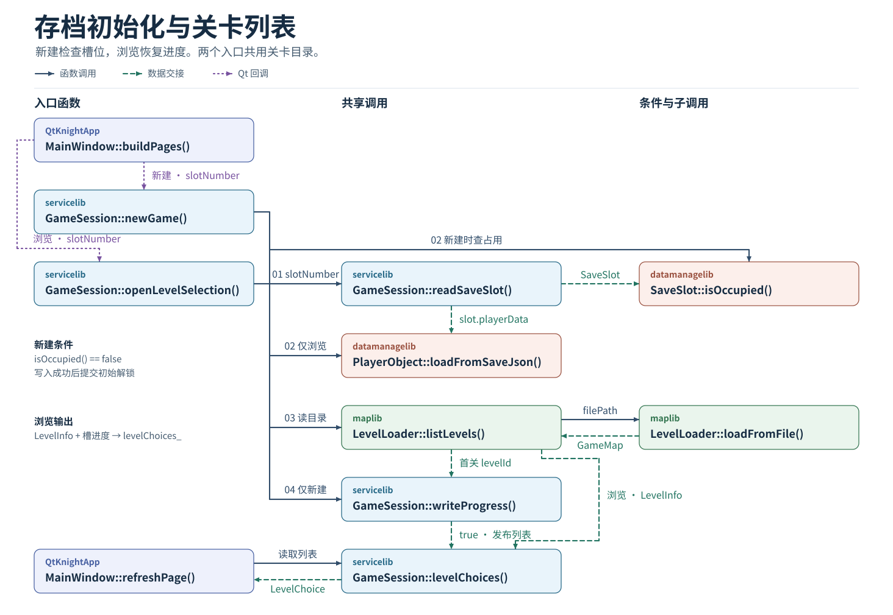

*图 3　存档初始化与关卡列表*

| 入口 | 槽记录处理 | 提交结果 |
| --- | --- | --- |
| `newGame(slotNumber, errorMessage)` | 读目标槽，确认 `isOccupied()` 为 `false`。 | 写入仅解锁第一关的初始进度。写入成功后发布列表并进入选关。 |
| `openLevelSelection(slotNumber, errorMessage)` | 读所选槽，将 `slot.playerData` 交给 `PlayerObject::loadFromSaveJson()`。 | 按所选槽的 `unlockedLevels` 和 `completedLevels` 生成列表。 |

两个入口通过 `LevelLoader::listLevels()` 获取 `LevelInfo`。目录扫描调用 `loadFromFile()` 校验各关配置，同时检查关卡编号冲突。会话组装 `levelChoices_`，`refreshPage()` 通过 `levelChoices()` 读取名称、简介与状态标记。

### 3.3 关卡加载与世界提交

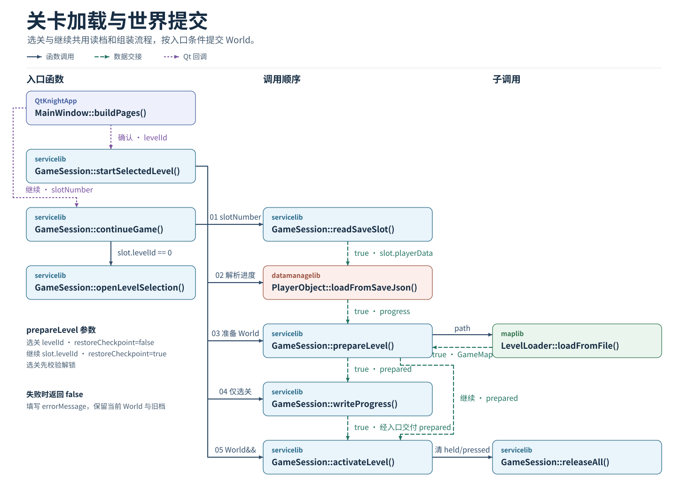

*图 4　关卡加载与世界提交*

两个入口先调用 `readSaveSlot()`。`continueGame()` 遇到 `slot.levelId == 0` 时转入 `openLevelSelection()`。需要准备关卡时，将 `slot.playerData` 解析为本次使用的 `PlayerObject progress`。选关入口还要复核解锁状态。

| 入口 | `prepareLevel()` 参数 | 启用条件 |
| --- | --- | --- |
| `startSelectedLevel()` | 选中的 `levelId`，`restoreCheckpoint = false` | 准备成功后调用 `writeProgress(prepared, slotNumber, errorMessage)`，写入成功才启用。 |
| `continueGame()` | 已保存的 `slot.levelId`，`restoreCheckpoint = true` | 准备成功即启用候选世界。 |

`prepareLevel()` 将关卡路径交给 `LevelLoader::loadFromFile()`，把输出的 `GameMap`、对象生成项与 `progress` 组装为 `prepared`。恢复检查点时使用有效检查点的位置，否则取关卡默认出生点。

入口将准备好的对象以 `World&&` 交给 `activateLevel()`。启用时替换 `world_`，清除 `held` 和 `pressed`，进入 `Playing`。读取、解析、校验或写入失败时，入口返回 `false` 并填写 `errorMessage`，保留原世界与槽文件。

### 3.4 世界对象构造与释放

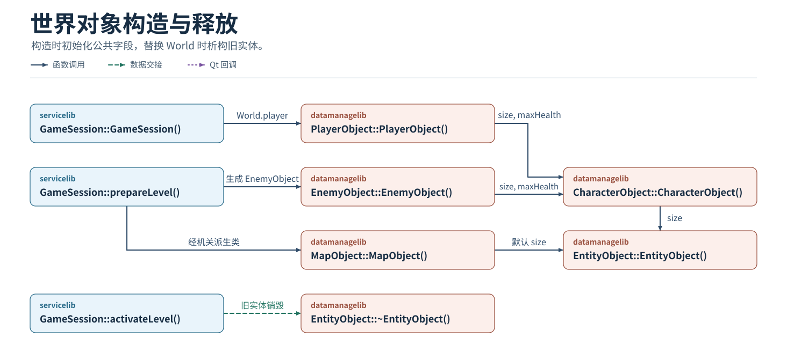

*图 5　世界对象构造与释放*

会话构造 `World` 时初始化玩家成员。`prepareLevel()` 按生成项构造敌人与地图机关，填入坐标、尺寸及类别字段。玩家和敌人的构造函数将 `size` 与 `maxHealth` 传给 `CharacterObject`。机关通过派生类构造进入 `MapObject`，两条构造路径都使用 `EntityObject` 初始化空间属性。

`activateLevel()` 提交新世界后，旧实体随原容器释放。派生实体销毁时执行 `EntityObject` 的虚析构。

## 4. 固定步与规则结算

### 4.1 输入映射与固定步调度

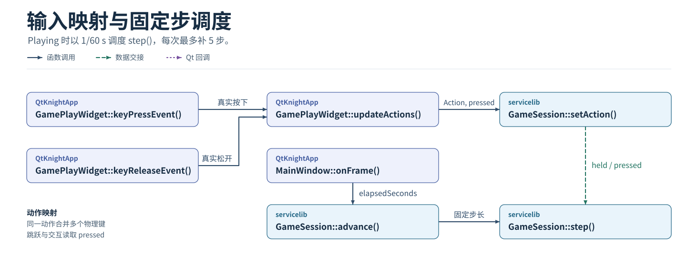

*图 6　输入映射与固定步调度*

`keyPressEvent()` 和 `keyReleaseEvent()` 更新物理按键集合。`updateActions()` 按绑定归并按键，将实际变化的 `Action` 和 `pressed` 交给 `setAction()`。同一动作绑定多个键时，释放其中一键后按其余绑定键决定动作状态。跳跃和主动交互读取按下沿。

`onFrame()` 把 `elapsedSeconds` 交给 `advance()`。`Playing` 时以 `1 / 60 s` 为步长调用 `step()`，一次最多补 5 步。每步先推进计时、敌人决策和移动，再结算战斗及符合条件的交互。

### 4.2 敌人决策与移动碰撞

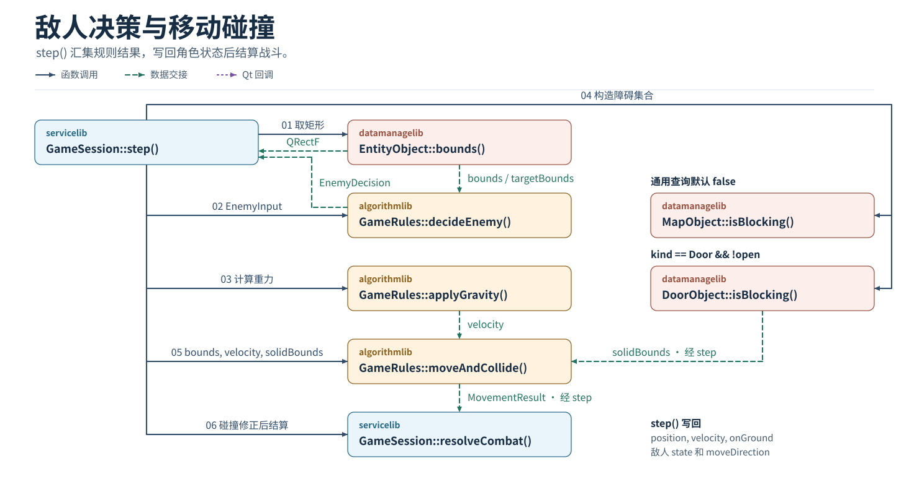

*图 7　敌人决策与移动碰撞*

1. `step()` 调用 `bounds()` 取得角色矩形，组装 `EnemyInput`。`decideEnemy()` 返回 `EnemyDecision`，会话更新敌人的 `state` 和 `moveDirection`，将 `attackRequested` 交给战斗结算。
2. `applyGravity()` 计算本步速度。障碍集合从 `GameMap::solidBounds` 取得静态矩形，再加入关闭门的矩形。`MapObject::isBlocking()` 提供默认 `false`，门的重写处理 `kind == Door && !open`。
3. `moveAndCollide()` 接收矩形、速度、步长与障碍集合，返回 `MovementResult`。会话将结果写回 `position`、`velocity` 与 `onGround`，并使用修正后的站位进入 `resolveCombat()`。

### 4.3 攻击状态推进与命中判定

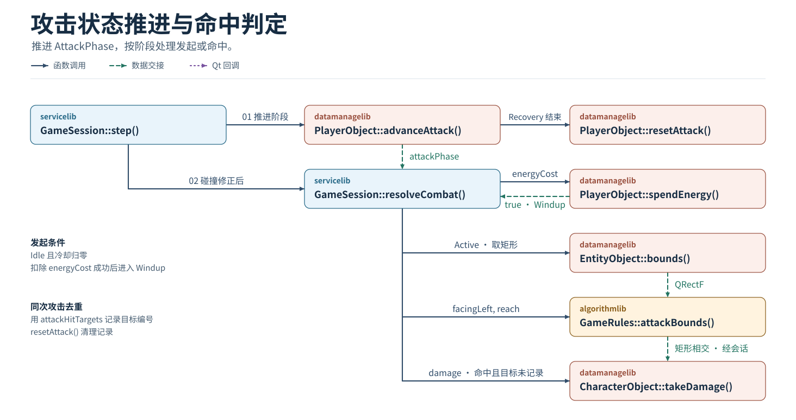

*图 8　攻击状态推进与命中判定*

`step()` 先调用 `advanceAttack()` 推进已有的 `AttackPhase`，收招结束时通过 `resetAttack()` 回到 `Idle` 并清理 `attackHitTargets`。

`resolveCombat()` 处理新的攻击请求。阶段为 `Idle` 且冷却归零时调用 `spendEnergy(energyCost)`，返回 `true` 才进入 `Windup`。阶段为 `Active` 时，通过 `bounds()` 和 `attackBounds()` 取得实际攻击矩形。矩形相交且目标编号尚未记录时调用 `CharacterObject::takeDamage(damage)`，并登记本次目标编号。

### 4.4 伤害结算与同帧分支

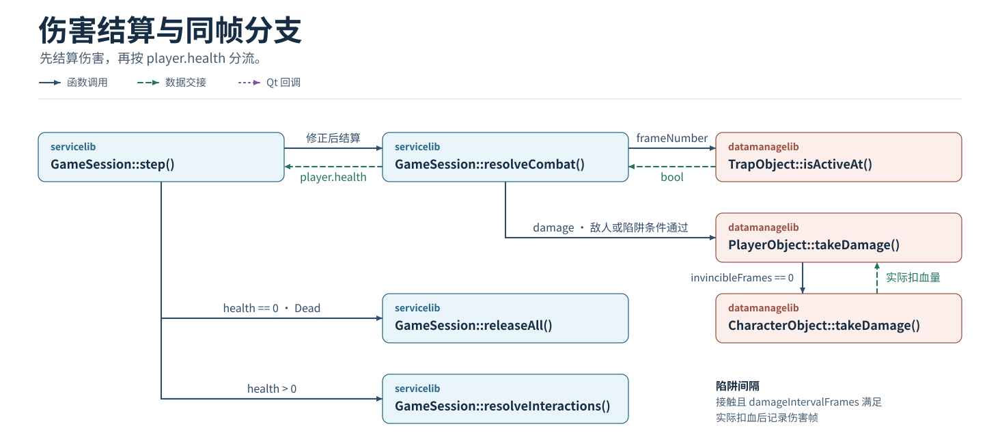

*图 9　伤害结算与同帧分支*

`resolveCombat()` 汇总本步的敌人攻击和有效陷阱伤害。陷阱要满足接触、`isActiveAt(frameNumber)` 与 `damageIntervalFrames` 条件。`PlayerObject::takeDamage()` 在 `invincibleFrames == 0` 时复用角色扣血函数。会话按实际扣血量提交结果，陷阱只在实际扣血后更新其伤害帧记录。

`step()` 在战斗完成后读取 `player.health`。为零时切换为 `Dead`，调用 `releaseAll()` 并结束本步。仍存活时调用 `resolveInteractions()`。

### 4.5 交互条件校验与结果提交

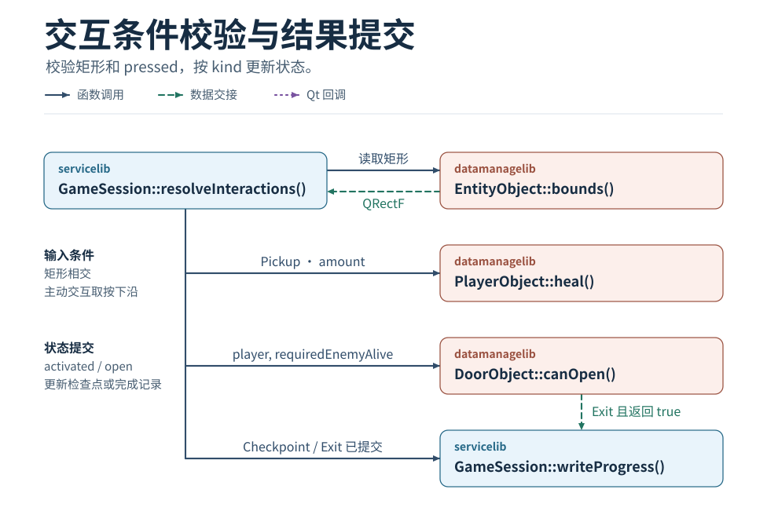

*图 10　交互条件校验与结果提交*

`resolveInteractions()` 先检查对象矩形。要求主动交互的对象还要匹配 `pressed`。按对象类别分别提交状态。

| 对象类别 | 会话处理 |
| --- | --- |
| `Pickup` | 更新相应玩家字段并设置 `activated`。生命值通过 `heal(amount)` 更新。 |
| `Checkpoint` | 设置 `activated` 和 `currentCheckpointId`，再调用 `writeProgress()`。 |
| `Door` | 向 `canOpen()` 传入玩家进度和 `requiredEnemyAlive`。返回 `true` 时更新 `open`。 |
| `Exit` | `canOpen()` 返回 `true` 时更新 `completedLevels`，有后续关卡时更新 `unlockedLevels`。会话随后进入 `LevelComplete` 并请求写入进度。 |

## 5. 进度与世界切换

### 5.1 存档序列化与写入重试

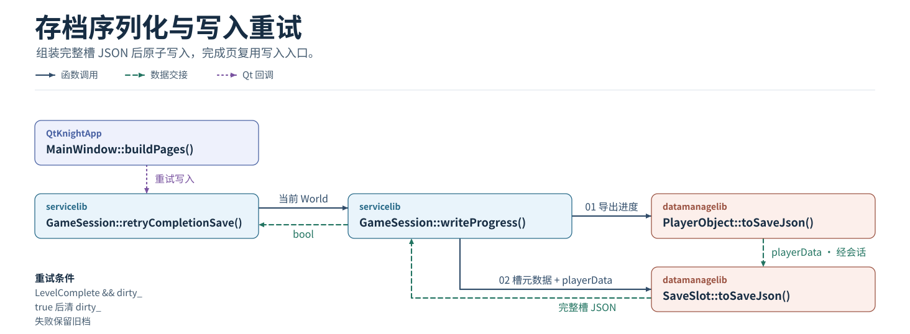

*图 11　存档序列化与写入重试*

`writeProgress()` 从当前或候选世界读取可恢复进度。`PlayerObject::toSaveJson()` 将检查点编号、可恢复的生命与能量以及永久记录导出为 `playerData`。`SaveSlot::toSaveJson()` 将它与槽位元数据和格式版本组装为完整 JSON。会话完成原子写入。恢复时按关卡和检查点重建对象，重新设置位置、速度和攻击状态。

检查点或通关后的写入失败时，保留内存进度及旧档，标记 `dirty_` 并提交失败反馈。`retryCompletionSave()` 只在 `LevelComplete && dirty_` 成立时调用 `writeProgress()`。成功后清除 `dirty_`，留在完成页。

### 5.2 检查点重建与切关

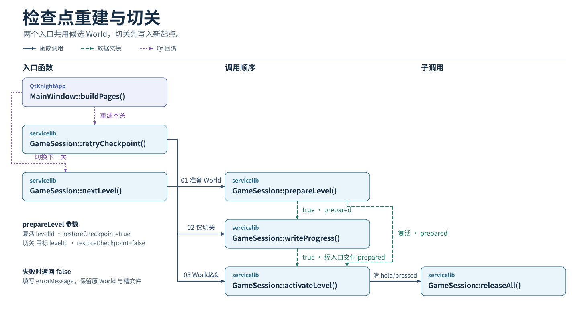

*图 12　检查点重建与切关*

| 入口 | 准备数据 | 提交条件 |
| --- | --- | --- |
| `retryCheckpoint()` | 当前关卡编号、内存进度和 `restoreCheckpoint = true`。 | 准备成功后启用候选世界，带入尚未写盘的进度。 |
| `nextLevel()` | 目标关卡编号、继承的进度和 `restoreCheckpoint = false`。 | 将候选世界的新起点写入槽文件，写入成功后启用。 |

两个入口复用 `prepareLevel()` 和 `activateLevel()`。启用时清理上一世界的动作。准备或写入失败时返回 `false` 并填写 `errorMessage`，保留原世界、槽文件和发起页面。

## 6. 窗口事件与输出

### 6.1 暂停状态与输入清理

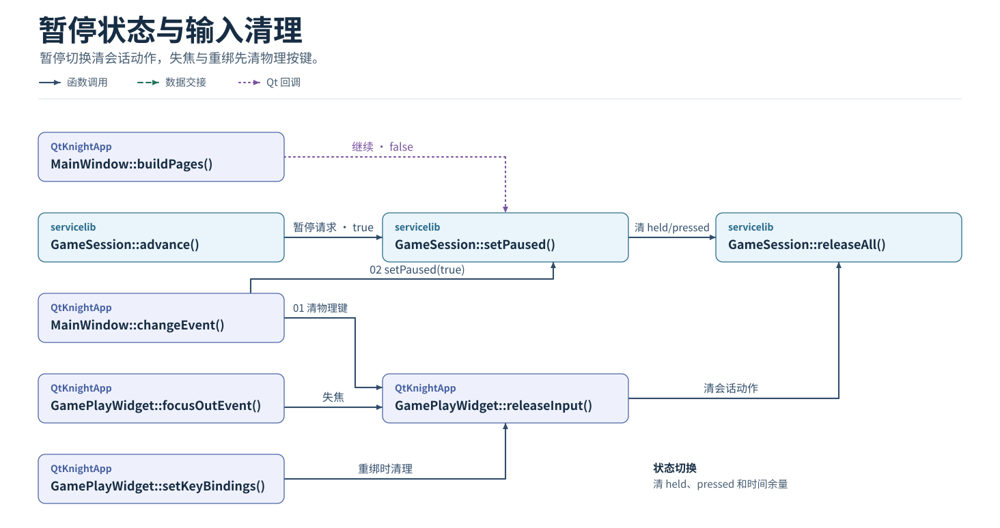

*图 13　暂停状态与输入清理*

会话处理暂停请求时调用 `setPaused(true)`，继续回调调用 `setPaused(false)`。状态切换清除会话动作和累计时间余量。

窗口失活时，`MainWindow::changeEvent()` 先让画布清理物理键，再暂停会话。`focusOutEvent()` 调用 `releaseInput()`，`setKeyBindings()` 重绑时先复用该清理入口。`releaseInput()` 清除物理按键集合，然后调用 `releaseAll()` 清除会话动作。

### 6.2 画面提交与分层绘制

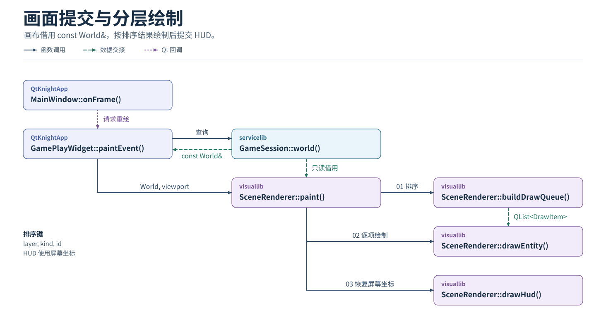

*图 14　画面提交与分层绘制*

`MainWindow::onFrame()` 推进会话后请求重绘。`paintEvent()` 读取 `world()`，将 `const World&` 与视口交给 `SceneRenderer::paint()`。绘制项在本次绘制期间借用实体地址。

`paint()` 计算受地图范围约束的相机变换。`buildDrawQueue()` 按图层、类别和对象编号排序，`drawEntity()` 按顺序绘制。世界层依次处理背景、地形、陷阱与交互物、角色、门与出口、特效和前景。世界绘制结束后恢复屏幕坐标，`drawHud()` 输出状态和提示。

### 6.3 音效资源初始化与反馈播放

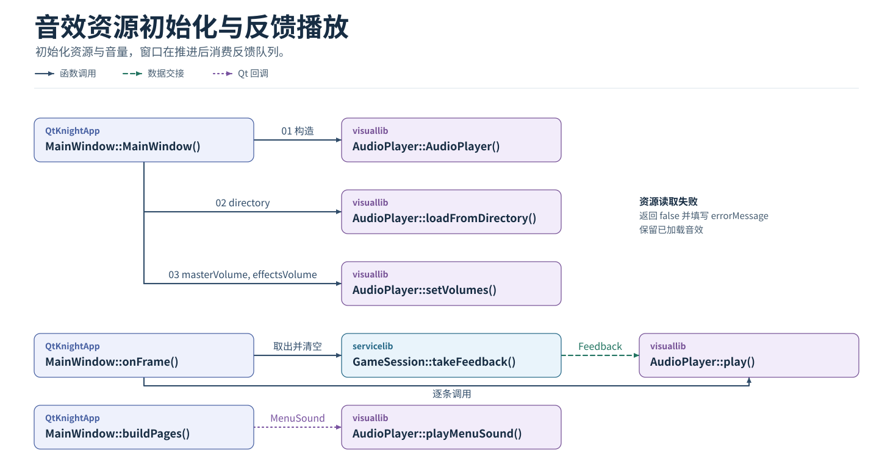

*图 15　音效资源初始化与反馈播放*

主窗口构造 `AudioPlayer`，通过 `loadFromDirectory()` 读取资源，通过 `setVolumes(masterVolume, effectsVolume)` 应用音量。读取失败返回 `false` 并填写 `errorMessage`，保留已加载音效。

每次推进会话后，`onFrame()` 调用 `takeFeedback()` 取出并清空队列，将每个 `Feedback` 交给 `play()`。菜单回调将 `MenuSound` 交给 `playMenuSound()`。

### 6.4 会话退出与进度确认

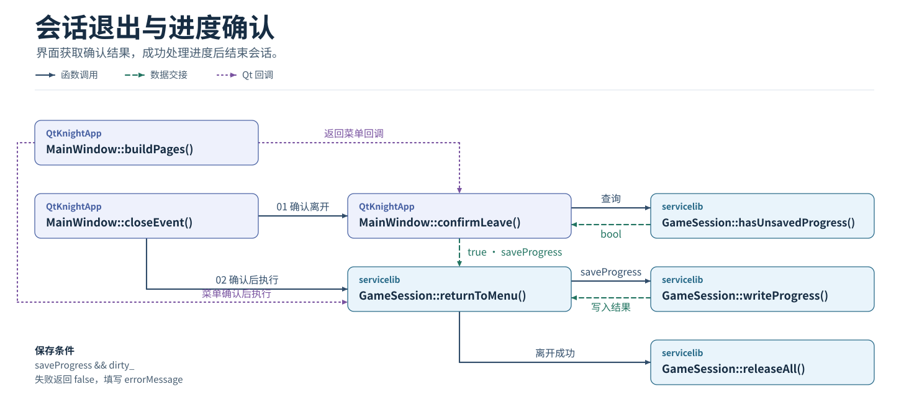

*图 16　会话退出与进度确认*

返回菜单回调与 `closeEvent()` 共用 `confirmLeave()`。界面通过 `hasUnsavedProgress()` 决定是否询问进度处置。`confirmLeave()` 返回 `false` 时取消离开，返回 `true` 时将 `saveProgress` 交给 `returnToMenu()`。

会话在 `saveProgress && dirty_` 成立时调用 `writeProgress()`。写入失败返回 `false` 并填写 `errorMessage`，保持原会话。离开成功后清理输入，界面返回主菜单或接受关窗。

## 附录 函数索引

### QtKnightApp

| 函数 | 业务作用 | 对应流程图 |
| --- | --- | --- |
| `GamePlayWidget::GamePlayWidget()` | 绑定会话，让输入和绘制使用同一个世界 | 《应用初始化与槽位读取》 |
| `GamePlayWidget::setKeyBindings()` | 应用动作与物理键的对应关系，支持一项动作绑定多个键 | 《暂停状态与输入清理》 |
| `GamePlayWidget::releaseInput()` | 一起清理物理按键和会话动作，处理失焦与重绑 | 《暂停状态与输入清理》 |
| `GamePlayWidget::paintEvent()` | 在 Qt 重绘时借用世界并交给渲染器 | 《画面提交与分层绘制》 |
| `GamePlayWidget::keyPressEvent()` | 捕获真实按下，提供动作状态变化 | 《输入映射与固定步调度》 |
| `GamePlayWidget::keyReleaseEvent()` | 捕获真实松开，为动作合并提供最新按键集合 | 《输入映射与固定步调度》 |
| `GamePlayWidget::focusOutEvent()` | 画布失焦时启动输入清理 | 《暂停状态与输入清理》 |
| `GamePlayWidget::updateActions()` | 把物理键集合合并为会话动作状态 | 《输入映射与固定步调度》 |
| `MainWindow::MainWindow()` | 用内容与用户数据目录装配会话、页面和表现组件 | 《应用初始化与槽位读取》 |
| `MainWindow::closeEvent()` | 接入系统关窗，按确认选择和保存结果决定是否关闭 | 《会话退出与进度确认》 |
| `MainWindow::changeEvent()` | 窗口失活时清理输入并暂停 | 《暂停状态与输入清理》 |
| `MainWindow::buildPages()` | 建立页面，将按钮连接到对应会话入口 | 《应用初始化与槽位读取》 |
| `MainWindow::refreshPage()` | 按会话状态刷新页面、槽位与关卡列表 | 《应用初始化与槽位读取》 |
| `MainWindow::onFrame()` | 用经过时间驱动会话，然后转交反馈和请求重绘 | 《输入映射与固定步调度》 |
| `MainWindow::confirmLeave()` | 根据未保存进度返回保存、放弃或取消的决定 | 《会话退出与进度确认》 |

### servicelib

| 函数 | 业务作用 | 对应流程图 |
| --- | --- | --- |
| `GameSession::GameSession()` | 建立会话，保存关卡和存档目录并初始化世界成员 | 《应用初始化与槽位读取》 |
| `GameSession::readSaveSlots()` | 汇总三个槽，给界面返回空槽、有效槽或坏槽 | 《应用初始化与槽位读取》 |
| `GameSession::newGame()` | 仅为空槽写入初始进度，成功后进入选关 | 《存档初始化与关卡列表》 |
| `GameSession::continueGame()` | 根据槽内继续位置恢复游玩或转到选关 | 《关卡加载与世界提交》 |
| `GameSession::openLevelSelection()` | 用选中槽的解锁和通关进度建立选关列表 | 《存档初始化与关卡列表》 |
| `GameSession::startSelectedLevel()` | 复核解锁，统筹加载、起点存档与启用 | 《关卡加载与世界提交》 |
| `GameSession::retryCheckpoint()` | 按内存检查点复活，带上尚未写盘的进度 | 《检查点重建与切关》 |
| `GameSession::nextLevel()` | 准备下一关并保存起点，成功后切换 | 《检查点重建与切关》 |
| `GameSession::retryCompletionSave()` | 在完成页单独重试通关进度写盘 | 《存档序列化与写入重试》 |
| `GameSession::returnToMenu()` | 执行保存或放弃选择，完成离开与输入清理 | 《会话退出与进度确认》 |
| `GameSession::setAction()` | 记录动作的按住状态和真实按下沿 | 《输入映射与固定步调度》 |
| `GameSession::releaseAll()` | 清空已按住动作和待消费的按下沿 | 《暂停状态与输入清理》 |
| `GameSession::setPaused()` | 切换暂停状态，避免旧输入和时间余量带到继续 | 《暂停状态与输入清理》 |
| `GameSession::advance()` | 把经过时间换成有上限的固定逻辑步 | 《输入映射与固定步调度》 |
| `GameSession::world()` | 给绘制提供当前世界的只读借用 | 《画面提交与分层绘制》 |
| `GameSession::state()` | 向主窗口返回会话状态，用于切换页面 | 《应用初始化与槽位读取》 |
| `GameSession::levelChoices()` | 向选关页交付关卡简介及解锁、完成标记 | 《存档初始化与关卡列表》 |
| `GameSession::hasUnsavedProgress()` | 决定离开前是否需要询问进度处置 | 《会话退出与进度确认》 |
| `GameSession::takeFeedback()` | 取走并清空反馈，确保音效按事件消费 | 《音效资源初始化与反馈播放》 |
| `GameSession::prepareLevel()` | 用地图和玩家进度构建候选世界 | 《关卡加载与世界提交》 |
| `GameSession::activateLevel()` | 提交候选世界并清理上一局动作 | 《关卡加载与世界提交》 |
| `GameSession::readSaveSlot()` | 统一读取单个槽文件并调用槽数据解析 | 《应用初始化与槽位读取》 |
| `GameSession::writeProgress()` | 将完整进度原子写入槽文件，保护旧档 | 《存档序列化与写入重试》 |
| `GameSession::step()` | 按固定次序推进运动、战斗与同帧交互 | 《输入映射与固定步调度》 |
| `GameSession::resolveCombat()` | 协调挥击、陷阱和受伤，更新本步的战斗结果 | 《伤害结算与同帧分支》 |
| `GameSession::resolveInteractions()` | 统一提交拾取、检查点、门和出口的结果 | 《交互条件校验与结果提交》 |

### maplib

| 函数 | 业务作用 | 对应流程图 |
| --- | --- | --- |
| `LevelLoader::loadFromFile()` | 校验一关的 JSON 并交付 GameMap | 《关卡加载与世界提交》 |
| `LevelLoader::listLevels()` | 汇总关卡目录，并检查关卡编号冲突 | 《存档初始化与关卡列表》 |

### algorithmlib

| 函数 | 业务作用 | 对应流程图 |
| --- | --- | --- |
| `GameRules::applyGravity()` | 计算竖直速度并限制最大下落速度 | 《敌人决策与移动碰撞》 |
| `GameRules::moveAndCollide()` | 从位移与障碍得出实际矩形、速度和落地状态 | 《敌人决策与移动碰撞》 |
| `GameRules::attackBounds()` | 由站位、朝向和距离计算有效攻击矩形 | 《攻击状态推进与命中判定》 |
| `GameRules::decideEnemy()` | 把目标与环境信息转换为敌人状态、方向和攻击意图 | 《敌人决策与移动碰撞》 |

### datamanagelib

| 函数 | 业务作用 | 对应流程图 |
| --- | --- | --- |
| `CharacterObject::takeDamage()` | 统一角色扣血下限并返回实际扣血量 | 《攻击状态推进与命中判定》 |
| `CharacterObject::CharacterObject()` | 用派生类给出的尺寸和上限初始化满血角色 | 《世界对象构造与释放》 |
| `DoorObject::isBlocking()` | 将关闭的门与可通行的门或出口区分开 | 《敌人决策与移动碰撞》 |
| `DoorObject::canOpen()` | 集中判断钥匙、目标和指定敌人条件 | 《交互条件校验与结果提交》 |
| `EnemyObject::EnemyObject()` | 给新建敌人设置默认尺寸和满血状态 | 《世界对象构造与释放》 |
| `EntityObject::~EntityObject()` | 在派生实体销毁时执行基类析构，保证多态销毁 | 《世界对象构造与释放》 |
| `EntityObject::bounds()` | 把共享坐标与尺寸转为碰撞和交互可用的矩形 | 《交互条件校验与结果提交》 |
| `EntityObject::EntityObject()` | 集中初始化实体的公共空间属性 | 《世界对象构造与释放》 |
| `MapObject::isBlocking()` | 混合查询地图对象时为未重写的类型提供默认放行 | 《敌人决策与移动碰撞》 |
| `MapObject::MapObject()` | 机关派生类构造时统一初始化地图对象基类 | 《世界对象构造与释放》 |
| `PlayerObject::PlayerObject()` | 为新玩家建立默认尺寸、生命和能量 | 《世界对象构造与释放》 |
| `PlayerObject::takeDamage()` | 按玩家无敌规则过滤伤害，再复用基础扣血 | 《伤害结算与同帧分支》 |
| `PlayerObject::heal()` | 处理生命奖励并将回复限制在生命上限 | 《交互条件校验与结果提交》 |
| `PlayerObject::spendEnergy()` | 检查并扣除出招能量，余额不足时保留原值 | 《攻击状态推进与命中判定》 |
| `PlayerObject::advanceAttack()` | 推进起手、有效与收招阶段，供本步判定命中 | 《攻击状态推进与命中判定》 |
| `PlayerObject::resetAttack()` | 回到 Idle 并清掉阶段计数与本次命中集合 | 《攻击状态推进与命中判定》 |
| `PlayerObject::toSaveJson()` | 导出可恢复的玩家进度，供槽文件封装 | 《存档序列化与写入重试》 |
| `PlayerObject::loadFromSaveJson()` | 校验并恢复玩家进度，供继续、选关或进关 | 《存档初始化与关卡列表》 |
| `SaveSlot::isOccupied()` | 区分空槽和已建档槽，坏槽也视为占用 | 《应用初始化与槽位读取》 |
| `SaveSlot::toSaveJson()` | 把元数据、版本和玩家进度组装成完整槽 JSON | 《存档序列化与写入重试》 |
| `SaveSlot::loadFromSaveJson()` | 校验槽 JSON 并恢复槽位元数据与玩家进度 | 《应用初始化与槽位读取》 |
| `TrapObject::isActiveAt()` | 按逻辑帧统一判断常驻或周期陷阱的危险期 | 《伤害结算与同帧分支》 |

### visuallib

| 函数 | 业务作用 | 对应流程图 |
| --- | --- | --- |
| `AudioPlayer::AudioPlayer()` | 建立由 QObject 管理的音效播放对象 | 《音效资源初始化与反馈播放》 |
| `AudioPlayer::loadFromDirectory()` | 读取所需音效资源，失败时保留已有资源 | 《音效资源初始化与反馈播放》 |
| `AudioPlayer::setVolumes()` | 应用总音量和音效音量 | 《音效资源初始化与反馈播放》 |
| `AudioPlayer::play()` | 把会话确认的一条反馈转成对应音效 | 《音效资源初始化与反馈播放》 |
| `AudioPlayer::playMenuSound()` | 按菜单确认或取消播放对应音效 | 《音效资源初始化与反馈播放》 |
| `SceneRenderer::paint()` | 组织相机、图层和 HUD 的整帧绘制 | 《画面提交与分层绘制》 |
| `SceneRenderer::buildDrawQueue()` | 按图层、类别和编号稳定排列绘制项 | 《画面提交与分层绘制》 |
| `SceneRenderer::drawEntity()` | 把单个已排序的绘制项画入世界 | 《画面提交与分层绘制》 |
| `SceneRenderer::drawHud()` | 恢复屏幕坐标后画生命、能量及提示 | 《画面提交与分层绘制》 |

### 禁用构造函数

- `GameRules::GameRules() = delete`。算法统一通过静态函数调用。
- `LevelLoader::LevelLoader() = delete`。关卡读取统一通过静态函数调用。
