# Qt Knight 单机游戏软件设计

## 1. 总体设计

### 1.1 模块职责

| 模块 | 职责 |
| --- | --- |
| `QtKnightApp` | `MainWindow` 调度页面、逻辑帧和输出。`GamePlayWidget` 处理键盘与失焦。 |
| `servicelib` | `GameSession` 管理世界、固定步、关卡切换和进度。 |
| `maplib` | `LevelLoader` 校验关卡文件，输出关卡配置或目录摘要。 |
| `algorithmlib` | `GameRules` 计算移动、碰撞、攻击范围和敌人决策。 |
| `datamanagelib` | 定义实体、关卡配置和存档记录。 |
| `visuallib` | `SceneRenderer` 绘制只读世界。`AudioPlayer` 播放反馈。 |

### 1.2 游戏业务总览

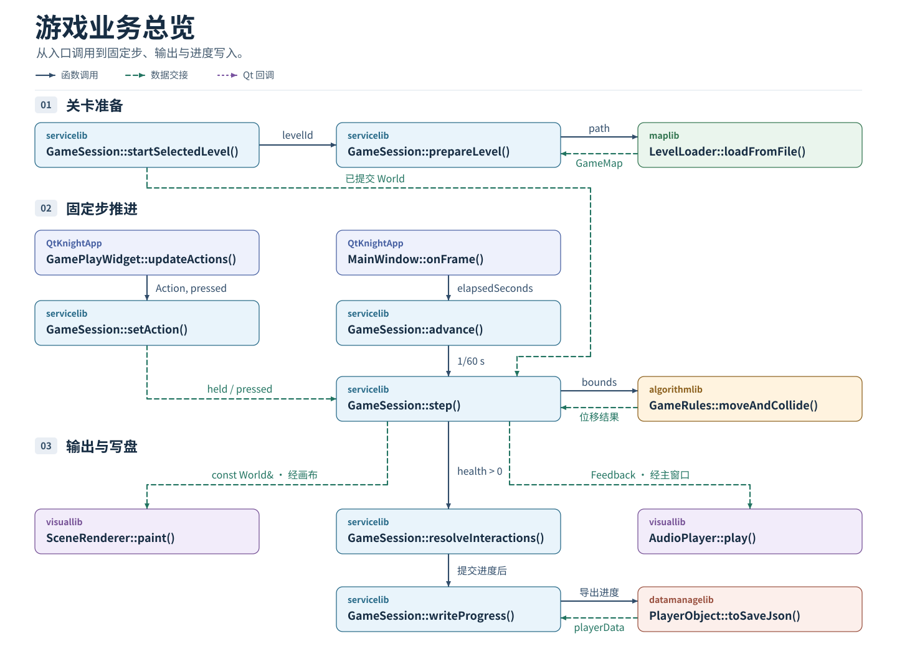

加载器将关卡文件解析为 `GameMap`，会话据此启用运行世界。游玩时，按键动作和帧时间分别进入会话。更新后的 `World` 供画布读取，音效和进度写入使用会话已确认的结果。

## 2. 数据归属与会话状态

### 2.1 数据归属

| 数据 | 所有者与用途 |
| --- | --- |
| `World` | 会话持有 `GameMap`、运行实体、逻辑帧号和提示。绘制只读借用。 |
| `InputState` | 会话保存持续动作 `held` 与按下沿 `pressed`。 |
| `Feedback` | 会话记录已确认的结果，主窗口一次取出并清空。 |
| `SaveSlot` | 会话读写槽位元数据及可恢复进度。 |

### 2.2 datamanagelib 类定义

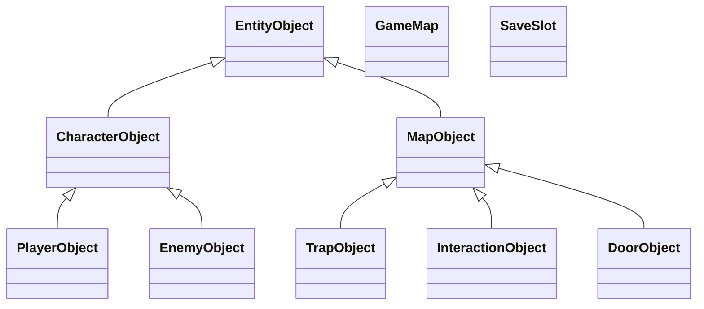

| 类型 | 数据与约定 |
| --- | --- |
| `EntityObject` | 编号、碰撞矩形的左上角 `position` 与宽高 `size`。 |
| `CharacterObject` | 朝向、速度、落地、生命与攻击冷却。扣血下限为 0。 |
| `PlayerObject` | 默认 24×46 像素，生命和能量上限为 5 和 30。持有跳跃次数、无敌帧、击退剩余帧 `knockbackFrames`、攻击阶段与命中记录。 |
| `EnemyObject` | 默认 42×38 像素、2 点生命。记录 `state`、巡逻起点和方向，方向 -1、0、1 分别表示左、停、右。 |
| `MapObject` | 共用空间字段，默认可通过。 |
| `TrapObject` | 伤害、危险周期、重复伤害间隔和击退速度。 |
| `InteractionObject` | 拾取物和检查点。`requiresInteraction` 决定触发方式，`activated` 记录交互结果。 |
| `DoorObject` | 门和出口。记录钥匙、敌人、目标条件及目标关卡。关闭的门阻挡移动。 |
| `GameMap` | 地图范围、出生点、静态障碍、`Spawn` 及运动、攻击、敌人规则。字段见附录 A。 |
| `SaveSlot` | 3 个槽位，记录关卡、时间、格式版本及 `playerData`。坏槽视为占用。关卡编号 0 表示尚未选关。 |

坐标右、下为正。位置用像素，速度用像素/秒，加速度用像素/秒²，计时用逻辑帧。

玩家进度保存生命、能量、能力位、钥匙、检查点、解锁与通关记录，以及已拾取、开门和目标完成状态。`currentCheckpointId = 0` 时使用默认出生点。

### 2.3 会话状态机

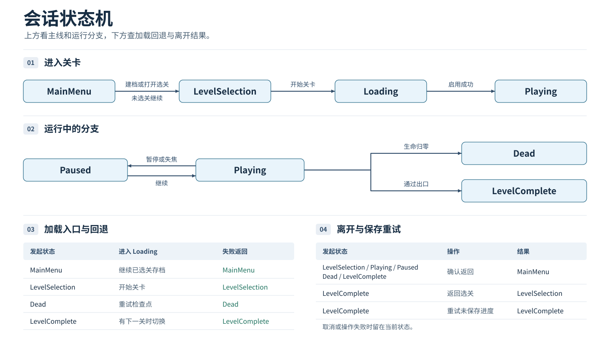

需要启用世界的入口先进入 `Loading`。提交成功才进入 `Playing`，失败回到对应的发起状态。游玩中发生暂停、死亡或通关时，主窗口读取会话状态并切页。

加载结束后处理离开请求。完成页返回选关前先处理未保存进度。放弃时用旧档组装列表，列表就绪后切页。

## 3. 初始化与世界提交

### 3.1 应用初始化与槽位读取

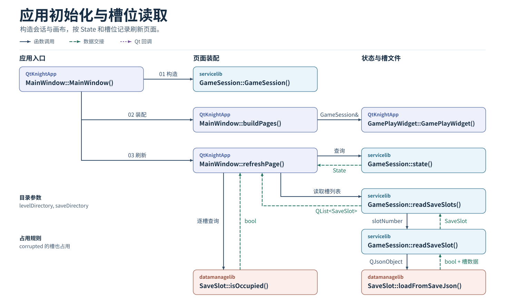

主窗口把关卡目录和存档目录交给会话，再装配输入层和画布。刷新主菜单时，会话逐槽读取并解析为 `SaveSlot`，界面用这份列表显示空槽和占用状态。目录读取失败时保留原列表。

### 3.2 存档初始化与关卡列表

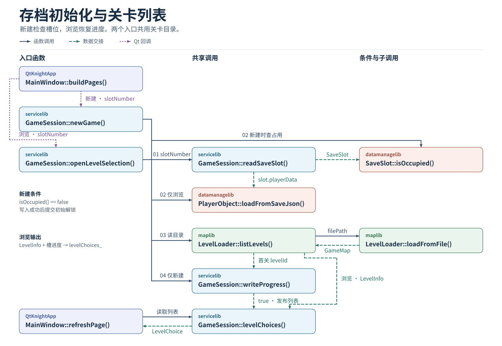

建档和浏览选关共用校验后的关卡目录。新档只写空槽，初始解锁第一关。浏览已有槽时，会话用槽位里的解锁和通关记录标记关卡列表，再把结果交给选关页。

### 3.3 关卡加载与世界提交

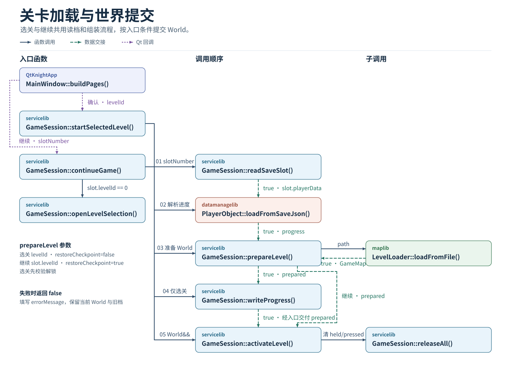

会话用槽位中的玩家进度和校验后的关卡配置准备候选 `World`。继续未选关的档案时直接打开选关页。确认选关和继续游戏共用加载过程，各自的启用条件见下表。

| 入口 | 世界启用条件 |
| --- | --- |
| 确认选关 | 复核解锁。候选世界准备成功且起点写入后启用。 |
| 继续游戏 | 恢复有效检查点，位置无效时使用默认出生点。准备成功后启用。 |

提交新世界时清输入。加载或写入失败保留原世界和槽文件。

#### 3.3.1 世界对象构造与释放

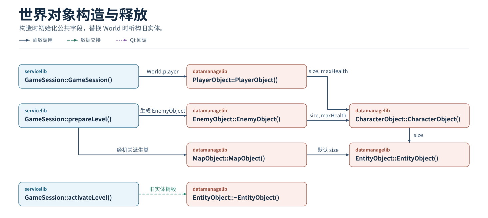

会话初始化玩家，再按生成项构造敌人和地图对象。位置和尺寸取自配置，共用属性由基类初始化。启用新世界时，旧实体随原容器释放。

## 4. 固定步与规则结算

### 4.1 输入映射与固定步调度

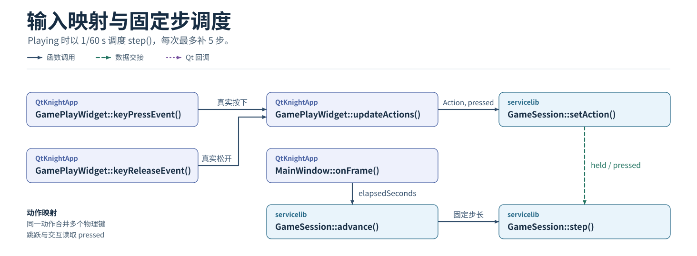

输入控件归并按键变化，把动作交给会话。主窗口另行提交经过时间，会话在 `Playing` 时以 1/60 秒为步长补步，一次最多 5 步。离开该状态即结束补步。

持续移动读取 `held`。跳跃、攻击和主动交互读取 `pressed`，按下沿留到下一步并在该步结束时清空。

#### 4.1.1 单步顺序

1. `frameNumber` 从 0 起，每步先加 1。无敌和双方攻击冷却各减 1，下限为 0。
2. 处理起跳和水平输入。左右同按取左，无输入方向为 0，方向非零时更新朝向。水平速度为方向乘以 `map.motion.speed`，击退速度优先。
3. 准备障碍、决策、应用重力、修正碰撞。推进已有挥击后结算战斗，玩家存活才处理交互。

### 4.2 移动与碰撞

#### 4.2.1 玩家跳跃与空中状态

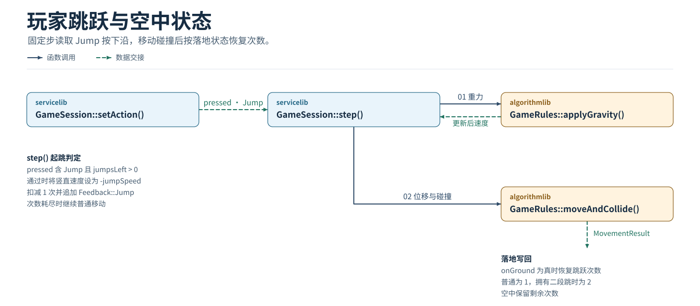

固定步先检查本步能否起跳，再把速度交给重力和碰撞计算。碰撞返回的落地状态决定是否恢复跳跃次数。

- `Jump` 按下且 `jumpsLeft > 0` 时，竖直速度设为 `-jumpSpeed`，扣 1 次并发出 `Feedback::Jump`。
- 落地恢复 1 次。二段跳能力位 `0x1` 恢复 2 次。空中和走下平台时沿用剩余次数，松键后仍按重力推进。

#### 4.2.2 敌人决策与移动碰撞

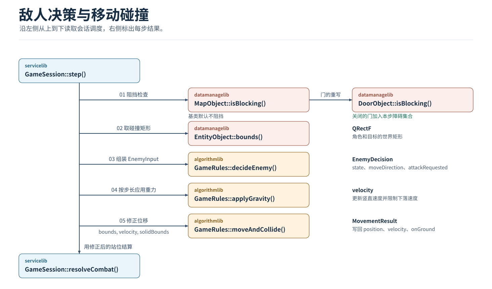

会话先把静态障碍和关闭的门合成当步障碍集合，再用角色与目标的矩形组装 `EnemyInput`。会话写回决策结果，再用 `MovementResult` 更新位置、速度和落地状态。

攻击就绪时，敌人的 `Attack` 状态承载本步出手意图。战斗按碰撞修正后的站位复核。

### 4.3 攻击状态推进与命中判定

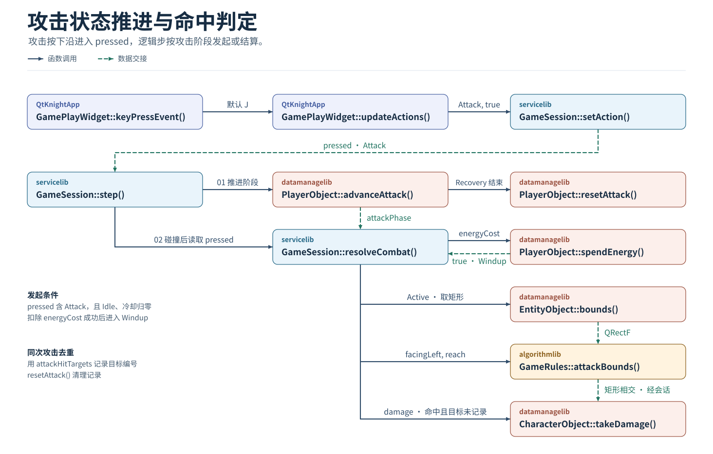

按键事件把攻击按下沿交给会话。会话先推进已有挥击，随后用修正后的站位结算。空闲分支检查发起条件，有效分支计算命中。

- 默认键 `J`。空闲、冷却归零且能量足够时，一次按下扣除 `energyCost`，进入起手并启动冷却。
- 阶段顺序为 `Idle → Windup → Active → Recovery → Idle`。阶段帧从 0 起，收招结束清空命中记录。
- 有效期从玩家朝向的边缘外伸 `reach`，攻击矩形与玩家同高。与存活敌人有正面积重叠才命中，每次挥击按 `attackHitTargets` 去重。

### 4.4 伤害结算与同帧分支

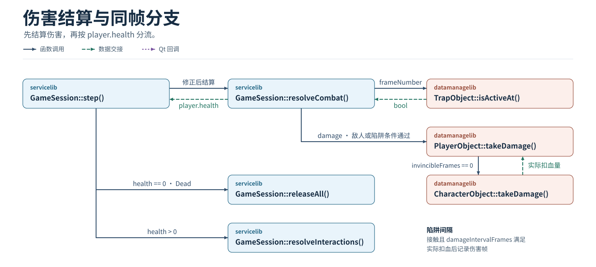

移动修正后，会话先收集敌人攻击，再收集有效陷阱伤害。同帧取最高值，同值取先收集者。无敌时实际扣血为 0。

实际扣血后开启受击无敌并发出反馈。生命归零进入 `Dead` 并清理动作，仍存活才处理本步交互。

#### 4.4.1 陷阱伤害

- 相交且处于危险期才检查间隔。`periodFrames == 0` 时持续危险，否则在 `(frameNumber % periodFrames + offsetFrames) % periodFrames < activeFrames` 时危险。
- 按陷阱编号查 `trapLastDamageFrames_`。缺记录直接通过间隔检查，有记录则要求帧差达到 `damageIntervalFrames`。只在该陷阱实际扣血后更新，离开陷阱保留记录，启用新世界时清空。
- 无敌时长是独立战斗参数，陷阱间隔只限制同一陷阱。

#### 4.4.2 敌人攻击与命中

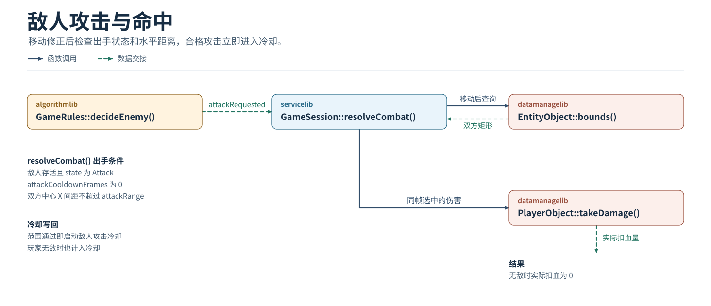

敌人决策的出手意图交给移动后的战斗阶段。会话筛出存活、处于 `Attack` 且冷却为 0 的敌人，用修正后双方矩形中心的水平间距复核命中。

距离不超过 `attackRange` 即提交 `attackDamage` 候选，并按 `map.enemy.attackCooldownFrames` 启动冷却。玩家无敌时仍计入冷却。身体接触只产生重叠，双方可穿过。

#### 4.4.3 陷阱击退

实际扣血且 `knockback > 0` 时，玩家在陷阱中心左侧取 `-knockback`，其余取 `+knockback`。设置 `knockbackFrames = 10`，击退速度覆盖水平输入，每步移动后减 1。撞墙或从空中落地立即清零，重力、竖直输入和无敌照常推进。

### 4.5 交互条件校验与结果提交

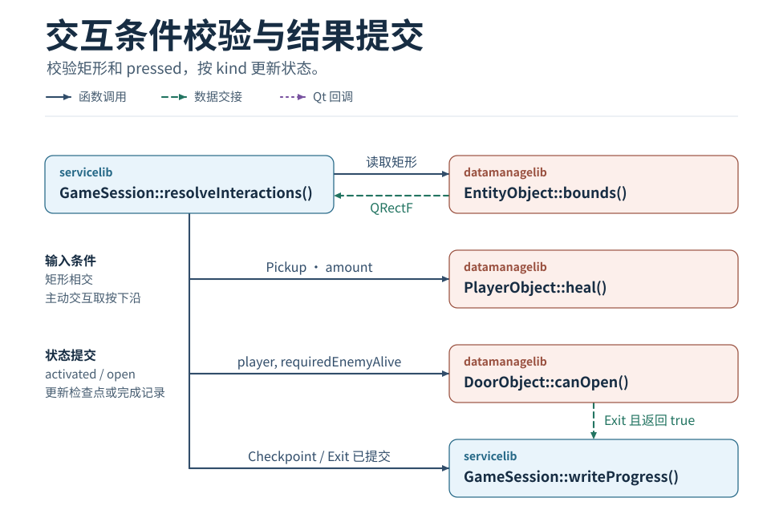

会话从当前世界筛选与玩家相交的对象，再检查触发条件。主动交互还需 `Interact` 按下沿。条件通过后，按对象类型写回状态，需要持久化的结果交给保存流程。

| 对象 | 提交结果 |
| --- | --- |
| 拾取物 | 发放奖励并标记已拾取。生命、能量按上限截断。 |
| 检查点 | 更新复活点，`energy = maxEnergy`，随后保存。 |
| 门 | 条件满足后开启。指定敌人的存活状态由会话提供。 |
| 出口 | 条件满足后完成本关并保存。有下一关则解锁，否则标记通关。 |

## 5. 进度与世界切换

### 5.1 存档序列化与写入重试

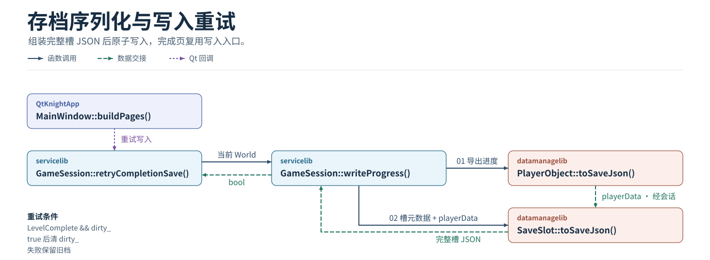

先从玩家状态提取 `playerData`，再与槽位元数据组装成完整 JSON，最后原子写入。完成页重试时，用当前内存进度重新组装并写入。恢复时重建世界，重置速度、攻击和击退等临时状态。

检查点或通关写入失败时保留旧档与内存进度，标记 `dirty_` 并提交失败反馈。完成页仅在有未保存进度时重试，成功后清除标记。

### 5.2 检查点重建与切关

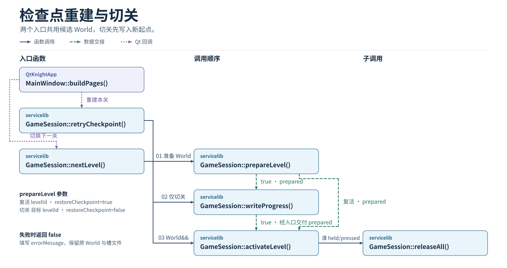

复活和切关都先准备候选 `World`，成功后再替换当前世界。复活使用内存里的检查点及最新进度。切关须先写入新关起点。提交后会话清理上一世界的输入。

## 6. 窗口事件与输出

### 6.1 游戏页控件层级

`pages_` 管理页面。游戏页用 `QStackedLayout::StackAll` 将透明的 `gameInput_` 放在 `gameCanvas_` 上方。输入层设置 `Qt::WA_TransparentForMouseEvents` 与 `Qt::StrongFocus`，进入游玩页时获取键盘焦点。

### 6.2 暂停状态与输入清理

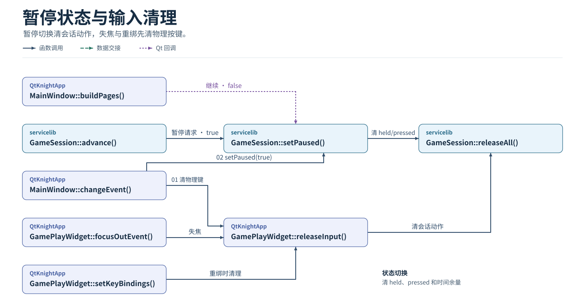

暂停和继续由会话切换状态，同时清动作与累计时间。失焦或重绑时由输入控件清物理键，再清会话动作。游玩时窗口失活，沿用这条清理路径后进入暂停。

### 6.3 画面提交与分层绘制

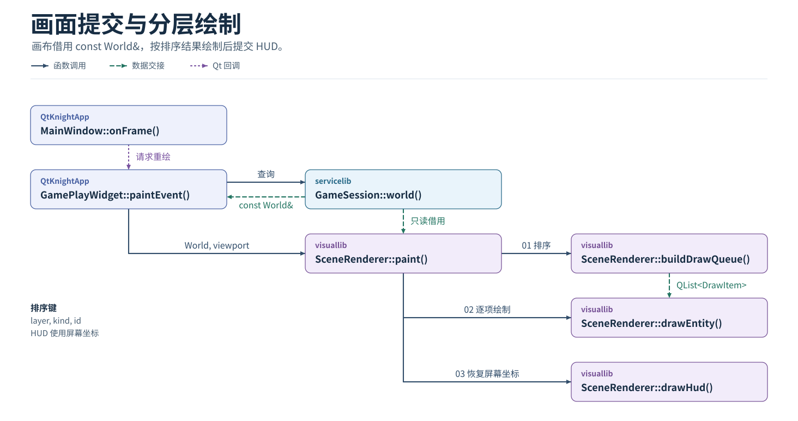

主窗口推进会话后提交重绘请求。Qt 把绘制事件交给独立画布，画布将只读 `World` 和自己的视口传给渲染器。实体引用限本次绘制。

相机限制在关卡范围内。实体按图层、类别和编号排序。顺序为背景、地形、陷阱与交互物、角色、门与出口、特效、前景。恢复屏幕坐标后绘制 HUD。

| HUD | 数据 | 位置或时机 |
| --- | --- | --- |
| 血量 | `health / maxHealth` | 左上 |
| 能量 | `energy / maxEnergy` | 血量下方 |
| 关卡名 | `map.name`、`frameNumber` | 左下，120 个逻辑帧内线性淡出 |
| 提示 | `world.message` | 屏幕中下，非空时显示 |

### 6.4 音效资源初始化与反馈播放

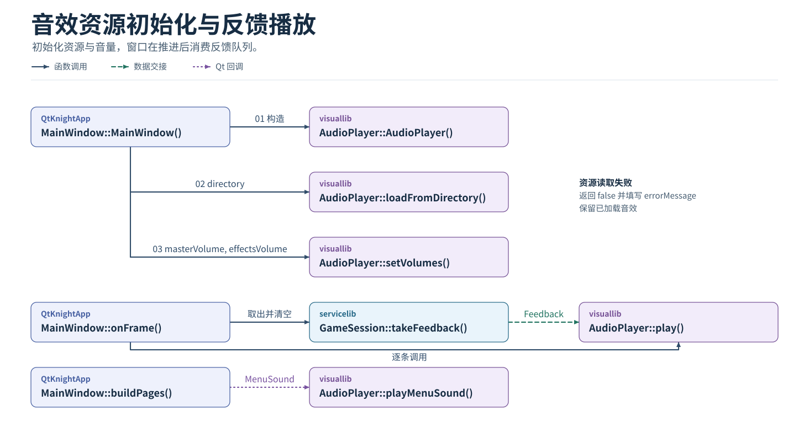

启动时主窗口准备音效资源并应用音量。每帧请求重绘后，主窗口取出并清空会话反馈，再逐条交给音效播放器。菜单确认和取消由对应回调播放。资源读取失败保留已加载音效。

### 6.5 会话退出与进度确认

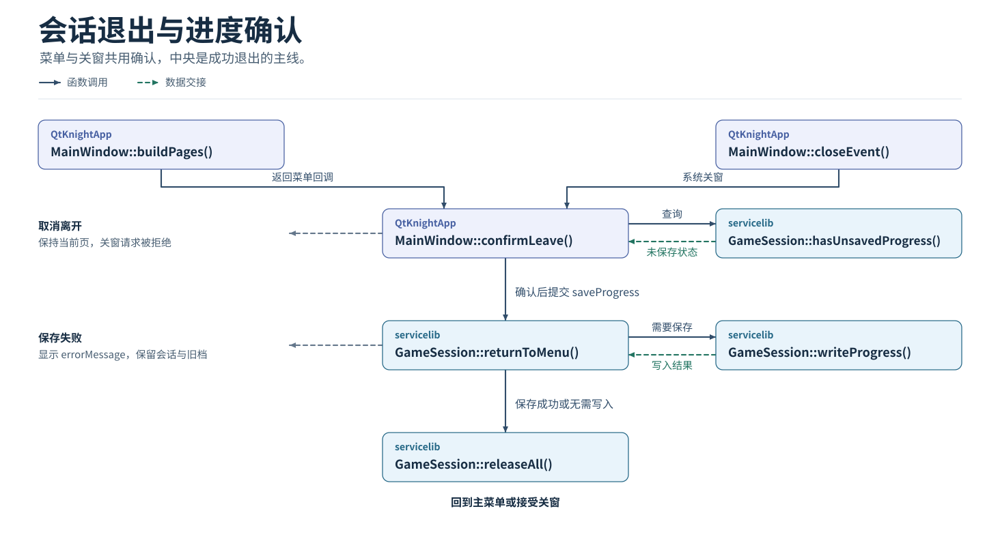

返回菜单和关窗共用进度确认。界面把确认结果交给会话，`saveProgress && dirty_` 时才写档。取消或写入失败保留当前会话，处理成功后清输入，再由原入口切页或关窗。

## 附录 A 关卡 JSON 格式

### A.1 文件和根对象

`MainWindow` 将内容目录下的 `levels/` 作为 `GameSession` 的关卡目录。文件名为 `level{N}.json`，`N` 为从 1 开始的十进制关卡编号，须与根对象的 `levelId` 一致。字段名与枚举值区分大小写。

| 必填字段 | JSON 类型 | 用途和范围 |
| --- | --- | --- |
| `levelId` | 整数 | 正整数关卡编号。 |
| `name`、`subtitle` | 字符串 | 关卡名称及简介。名称非空，简介可为空字符串。 |
| `nextLevelId` | 整数 | 下一关编号，0 表示没有下一关。 |
| `bounds` | 矩形对象 | 关卡范围和相机边界。 |
| `spawnPoint` | 点对象 | 默认玩家出生位置。 |
| `solidBounds` | 矩形数组 | 静态平台和墙体，允许空数组。关闭的门由会话纳入当步障碍。 |
| `spawns` | 对象数组 | 敌人与地图运行对象的生成描述。 |
| `motion` | 对象 | 玩家运动参数。 |
| `attack` | 对象 | 玩家攻击参数。 |
| `enemy` | 对象 | 敌人决策、移动与伤害参数。 |

点包含 `x`、`y`，矩形另含 `width`、`height`。位置均为世界坐标，右、下为正，单位为像素。矩形宽高为正。坐标与其他实数必须有限。整数配置须在对应的 C++ 字段范围内，`abilityMask` 使用 `quint32`。

### A.2 生成项

所有生成项均需提供正整数 `id`、字符串 `kind` 和矩形 `bounds`。`id` 在当前关内唯一。写入永久进度的拾取物编号和门编号分别在整套关卡内保持唯一且稳定。`kind` 决定读取下表的专用字段。

| `kind` | 专用字段 | 约定 |
| --- | --- | --- |
| `Enemy` | `health` | 正整数。会话初始化 `health` 和 `maxHealth` 为该值。 |
| `Trap` | `damage`、`periodFrames`、`activeFrames`、`offsetFrames`、`damageIntervalFrames`、`knockback` | 伤害为正，计时为非负整数逻辑帧。持续危险区的周期、危险帧数和偏移均为 0。周期陷阱的 `activeFrames` 取 1 至 `periodFrames`，`offsetFrames` 取 0 至 `periodFrames - 1`。击退为非负的水平速度大小，单位像素/秒。 |
| `Checkpoint` | `respawnPosition`、`requiresInteraction` | 复活位置为点对象。布尔字段 `requiresInteraction` 取 `true`，通过主动交互触发。 |
| `Pickup` | `subtype`。依奖励类型提供 `amount`、`keyItemId` 或 `abilityMask`。可选布尔字段 `requiresInteraction`。 | `Health`、`Energy` 使用正整数 `amount`。`Key` 使用正整数钥匙编号。`Ability` 使用非零能力位掩码，二段跳对应 `abilityMask = 1`。未配置交互开关时按接触触发。 |
| `Door` | `requiredKeyId`、`requiredEnemyId`、`requiredGoalId` | 各条件编号为非负整数。0 跳过该条件。 |
| `Exit` | 与 `Door` 相同，另需 `targetLevelId`。 | 目标编号与本关 `nextLevelId` 一致。0 表示最终出口。 |

`requiredEnemyId` 为正时必须指向本关的 `Enemy` 生成项。`requiredKeyId` 和 `requiredGoalId` 为正时分别匹配 `PlayerObject::keyItems` 与 `completedGoalIds`，这些记录可以由前序关卡授予。配置非零条件时须有对应的获取路径。`LevelLoader::loadFromFile()` 在临时 `GameMap` 上完成类型、几何、枚举、编号和字段范围校验，成功后才替换输出。`listLevels()` 检查目录内的关卡编号冲突与非零后续关卡引用，并复核写入永久进度的对象编号。`prepareLevel()` 根据运行期玩家尺寸检查出生或复活后的完整碰撞体，使用关卡范围、静态障碍与门状态判定位置是否可用。

### A.3 规则参数

三个参数对象中的所列字段均必填。

| 对象 | 字段和范围 |
| --- | --- |
| `motion` | `speed`、`jumpSpeed`、`maxFallSpeed` 为正实数，单位像素/秒。`gravity` 为非负实数，单位像素/秒²。 |
| `attack` | `damage` 为正整数，`energyCost` 为非负整数。`windupFrames`、`activeFrames`、`recoveryFrames` 为正整数，`cooldownFrames` 为非负整数，均以逻辑帧计。`reach` 为正实数，单位像素。 |
| `enemy` | `detectDistance`、`disengageDistance`、`attackRange` 为正实数，单位像素。`disengageDistance` 至少等于 `detectDistance`。`patrolSpeed`、`chaseSpeed` 为非负实数，单位像素/秒。`attackDamage` 为正整数，`attackCooldownFrames` 为正整数逻辑帧。 |

### A.4 level1.json 示例

示例使用单关配置，`nextLevelId` 和出口的 `targetLevelId` 均为 0。接入第二关时，两处改为 2，并在关卡目录提供 `level2.json`。

```json
{
  "levelId": 1,
  "name": "遗忘十字路",
  "subtitle": "起点",
  "nextLevelId": 0,
  "bounds": {"x": 0, "y": 0, "width": 3200, "height": 720},
  "spawnPoint": {"x": 100, "y": 500},
  "solidBounds": [
    {"x": 0, "y": 600, "width": 3200, "height": 120},
    {"x": 400, "y": 480, "width": 200, "height": 20},
    {"x": 800, "y": 380, "width": 150, "height": 20}
  ],
  "spawns": [
    {
      "id": 101,
      "kind": "Enemy",
      "bounds": {"x": 600, "y": 560, "width": 42, "height": 38},
      "health": 2
    },
    {
      "id": 201,
      "kind": "Trap",
      "bounds": {"x": 1000, "y": 590, "width": 100, "height": 10},
      "damage": 1,
      "periodFrames": 0,
      "activeFrames": 0,
      "offsetFrames": 0,
      "damageIntervalFrames": 30,
      "knockback": 100
    },
    {
      "id": 301,
      "kind": "Checkpoint",
      "bounds": {"x": 1500, "y": 550, "width": 40, "height": 50},
      "respawnPosition": {"x": 1510, "y": 554},
      "requiresInteraction": true
    },
    {
      "id": 401,
      "kind": "Pickup",
      "bounds": {"x": 450, "y": 450, "width": 20, "height": 20},
      "subtype": "Health",
      "amount": 1
    },
    {
      "id": 501,
      "kind": "Exit",
      "bounds": {"x": 3100, "y": 500, "width": 60, "height": 100},
      "requiredKeyId": 0,
      "requiredEnemyId": 0,
      "requiredGoalId": 0,
      "targetLevelId": 0
    }
  ],
  "motion": {
    "speed": 180,
    "jumpSpeed": 420,
    "gravity": 1200,
    "maxFallSpeed": 600
  },
  "attack": {
    "damage": 1,
    "energyCost": 3,
    "windupFrames": 6,
    "activeFrames": 4,
    "recoveryFrames": 8,
    "cooldownFrames": 20,
    "reach": 36
  },
  "enemy": {
    "detectDistance": 200,
    "disengageDistance": 350,
    "patrolSpeed": 60,
    "chaseSpeed": 120,
    "attackRange": 50,
    "attackDamage": 1,
    "attackCooldownFrames": 90
  }
}
```

## 附录 B 错误处理与存档重试

### B.1 错误传递与界面行为

文件读取、解析、保存等边界返回 `bool` 并通过 `QString& errorMessage` 传递原因。错误信息采用 `[模块名] 对象或路径加失败原因`，例如 `[LevelLoader] levels/level1.json 缺少 spawnPoint 字段` 或 `[GameSession] 关卡 3 未解锁`。上层沿用原始原因，`MainWindow` 根据操作入口决定如何提示。

| 情形 | 界面行为和数据约束 |
| --- | --- |
| 启动阻断（Fatal） | 必要资源不可读且无法初始化可用界面时，显示原因并结束本次启动。 |
| 操作失败（Error） | 关卡损坏或未解锁时，提示原因并留在发起页。损坏槽显示为占用。保存目录不可写等写入失败按 B.2 处理。 |
| 表现降级（Warning） | 音效资源加载失败时，保留已经可用的音效并提示，游戏流程继续。 |
| 操作成功（Info） | 刷新对应页面或按现有反馈队列显示结果。 |

### B.2 保存失败后的处理

`writeProgress()` 原子提交槽文件。写入失败保留旧档。检查点或关卡完成后的写入失败同时保留内存进度与 `dirty_`，后续写入由界面操作触发。

| 入口 | 重试或离开 |
| --- | --- |
| 开始关卡或进入下一关 | 失败时保留发起页面与原世界。修复原因后通过原按钮重新发起。 |
| 检查点写入 | 游戏继续使用内存里的复活点。后续存档动作可再次提交当前进度。 |
| 完成页 | 提供保存重试按钮，调用 `retryCompletionSave()`。成功后清除 `dirty_` 并留在完成页。 |
| 返回主菜单或关闭窗口 | 保存失败时保持会话。用户可重试，或明确确认放弃未保存进度后离开，保留旧档。 |
